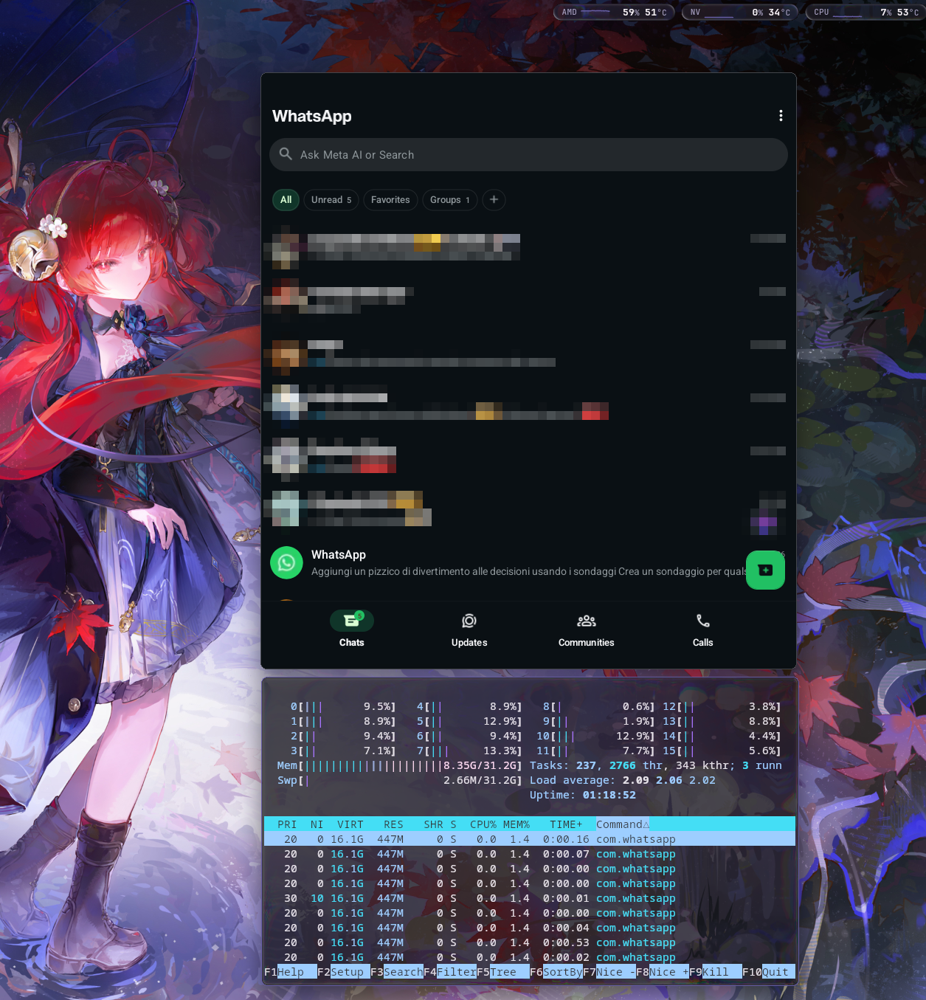

# Droidloom

Droidloom runs Android apps in separate Linux Wayland windows. It uses a shared
kernel Android userspace with real Android APIs, GPU acceleration and a native
desktop application catalog.

<p align="center">
  
</p>

This is an early preview. The package workflow targets x86_64 Arch Linux and
Omarchy with AMD or Intel graphics. WhatsApp and Phone have been tested on Omarchy
with Hyprland, including tiled resizing on an AMD/NVIDIA laptop using its AMD GPU.
NVIDIA rendering is not validated.

## Install the preview

Follow the **[step-by-step installation guide](docs/INSTALL.md)**, including
first-time setup and **[installing APKs](docs/INSTALL.md#5-install-an-apk)**.

1. Download and review the installer:

   ```console
   curl -fLO https://denialwm.github.io/droidloom/install.sh
   less install.sh
   ```

2. Run `sh install.sh` to add the pacman repository and install or update both
   packages. It asks for administrator access and keeps pacman's confirmation
   before a full system upgrade. Droidloom packages are currently unsigned over
   HTTPS; this policy is scoped to the Droidloom repository. Later updates also
   arrive through normal `sudo pacman -Syu`.
3. From your normal Wayland desktop terminal, run `droidloomctl start`. First start
   requests administrator authentication to create Android data, runtime
   configuration and the system-service permission. The guide includes an explicit
   setup command if the authentication prompt is unavailable.
4. Try `droidloomctl launch com.android.settings`, then follow the guide to install
   your APKs with `droidloomctl install /path/to/application.apk`.

Startup is manual; launching an app does not start a stopped runtime. Read
**[known issues](docs/KNOWN_ISSUES.md)** for compatibility limits and workarounds.

## Build it yourself

The **[build guide](docs/BUILDING.md)** covers prerequisites, disk space and package
checks. One Rust command builds the modified Android components, host binaries
and both pacman packages, without host sudo:

```console
cargo run --locked -j 1 -p droidloom-package -- build
```

## Use Droidloom

```console
droidloomctl start
droidloomctl applications
droidloomctl launch com.android.settings
droidloomctl stop
```

The desktop catalog exports app launchers. Clipboard sharing and desktop
notifications are implemented; compatibility depends on the app and compositor.
See [integration and limitations](docs/desktop-integration.md) before trying the preview.

## Development

- [Documentation](docs/README.md): architecture, desktop integration and contracts.
- [Tools](tools/README.md): package builder, source updater and specialist helpers.
- `runtime/`: supervisor, CLI, application catalog and installation support.
- `graphics/`: Wayland presenter, input, Composer and private host transport.
- `android/`: Android components, patches and pinned upstream inputs.
- `packaging/`: pacman metadata, service units and lifecycle integration.

Run `cargo check --locked --workspace -j 1` to check host Rust code. This does not
build Android or install anything. Generated sources, images and packages are
not tracked in Git.

Droidloom's original code is **GPL-3.0-or-later**. See [LICENSE](LICENSE),
[the complete GPLv3 text](LICENSES/GPL-3.0-or-later.txt) and
[third-party licenses](THIRD_PARTY.md).

### Normal journal catalog update

The fixed normal `systemd-journal-catalog-update.service` invokes the unchanged
`journalctl --update-catalog`. Its normal source contract binds thirteen systemd
source documents, the selected kernel proc-inode labeling source, and five
normal installed files. The independent controller must read those inputs;
the policy producer checks their fixed contract and actual linked permissions.
R13 recorded the service's exit status 1 but retained no child AVC for this
operation. The two own-proc permissions are a source and old-policy diagnosis.

The selected kernel labels task proc inodes with the task SID. Normal catalog
input import reopens a held public input as `/proc/self/fd/N`; journalctl therefore
needs only its own directory search and symlink read. All original generic
directory and file vectors remain unchanged. No journal database body, private
configuration, capability, socket or ioctl access is added.

The normal root already contains `/var/lib/systemd/catalog`. Its exact directory
alias permits the original four read/traversal operations plus write,
add_name and remove_name. The output alias covers only the regular
`database` and normal `.#database<16 lowercase hexadecimal digits>` files.
The unchanged temporary-file helper opens with O_RDWR|O_CREAT|O_EXCL and 0600,
so the complete eight-permission file lifecycle includes read as well as write.
Normal code writes, flushes, attempts chmod 0644, renames into place and unlinks
on failure. This path does not call fsync. Parent creation and generic
`/var/lib/systemd` write are outside the policy.

Every other concrete actor retains its original class-specific view, complete
raw TE, all sampled source/target categories, ioctl filters and transitions. The
two original metadata actors retain only their existing native-data directory
getattr/search preimage on the new file label; all other off-class vectors are
zero and the complete incoming table is checked.
Full original ordinary/MLS/relabel constraints are retained. The one directory
identity guard is kept verbatim: its sole hardware-label actor has neither
relabelfrom nor relabelto on the old or new directory type, while other actors
take the original neq branch. No type-identity predicate is discarded. The final verifier
checks every actor/class incoming vector of the two new types, journalctl's
exact lifecycle and class-aware neighboring paths. Catalog precedes seed:
seed explicitly inherits only its original two root-directory metadata bits,
and no catalog file access. A normal full-policy link and runtime service
success remain separate qualification requirements.
