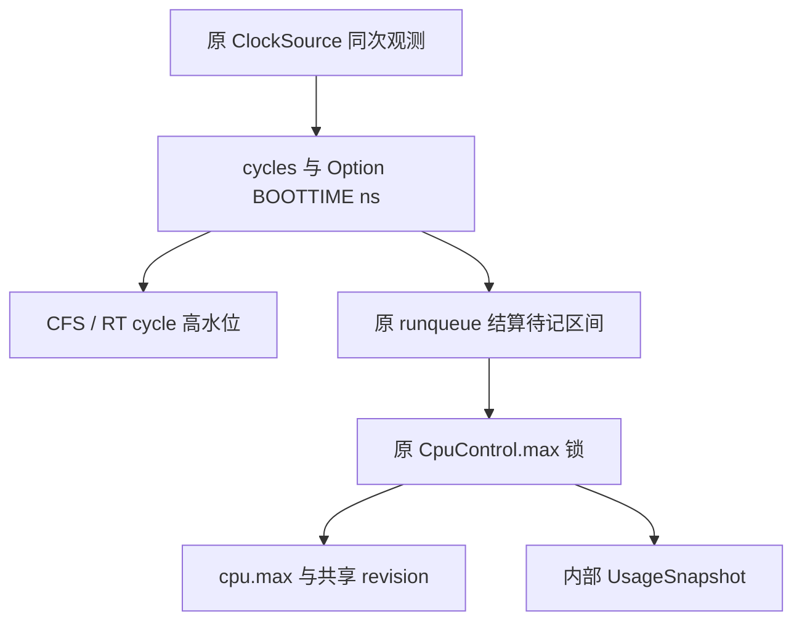

# A06 G1-b：原 CPU owner 的纳秒记账与内部一致快照

更新：2026-10-19。本文描述 G1-b 开发切片的当前实现及验收边界，配套
[开发与验证手册](../tests/organ_backend/CPU_USAGE_G1B.md)。最终执行 head `4d3011cf…` 已通过完整 core220/OSTD221（3 soft skip）、七完整负控和普通 Linux/CPU 门槛，并于 11:34:07 UTC 正常合入 #205；实际树、ELF、原串口及独立审查见
[完整验收与全模块报告](../results/integration/2026-10-19-g1b-usage/README.md)。这只闭合内部纳秒计费与一致快照切片，**不表示四项用户态资源操作、可信授予或完整 G1 已完成**。下文开发过程和早期 WIP 记录保留各自发生时点；早期本地原件的恢复范围见该报告的 RECOVERY。
19 个新增测试连同真实 lease 清理修复的独立交付提交为
`6004306b627e32de2f3ae7fb5fc757418e655c65`；这是测试源码身份，不是最终产品提交或实际运行身份。
首轮旧 16 测试版本已实际暴露夹具删除时的 EBUSY，详情及修复顺序见第 8 节；
不能将格式检查或这次修复提交表述为新的完整客体通过。

本切片把既有 cgroup CPU owner 的带宽计算统一到原校准时钟的纳秒端点，增加私有的
`read_native_cpu_usage_for_owner` 观察入口。[HOS2 设备](../kernel/asterinas/kernel/core/src/device/misc/hepta_control.rs)
仍只宣告 QueryAbi；生产 bootstrap 尚不调用 G1-a 绑定入口，用户态 ReadUsage、InstallBudget、
QueryDelivery、RetireThrough 四项操作仍未开放。内部 `UsageSnapshot` 不授予权限，也不是已完成的 HOS2 wire 响应。

## 1. 与此前切片的关系

[G1-a 手册](ASTERINAS_CPU_OWNER_G1A.md)记录一次性身份绑定、共享带宽 revision 和不可逆关闭；
[配置结算手册](../tests/organ_backend/CPU_CONFIG_SETTLEMENT.md)、
[原 owner 保留手册](../tests/organ_backend/CPU_OWNER_RETENTION.md)、
[时钟手册](../tests/organ_backend/CPU_BOOTTIME_CLOCK.md)及
[调度交接手册](../tests/organ_backend/CPU_SCHEDULER_HANDOFF.md)保留各自的实现和交付时点。
其中关于 TSC 带宽单位、当时尚缺纳秒快照的描述属于原切片历史；本手册说明当前单位和接口，
不覆盖旧结果，也不把旧提交的 ELF 或通过计数赋予新的组合树。

| 当前源码 | 职责 |
| --- | --- |
| [cpu.rs](../kernel/asterinas/kernel/core/src/fs/fs_impls/cgroupfs/controller/cpu.rs) | 原 `CpuMax` 的配置、纳秒窗口、累计用量、历史欠额及共享 owner 计费 |
| [cpu/native.rs](../kernel/asterinas/kernel/core/src/fs/fs_impls/cgroupfs/controller/cpu/native.rs) | 同锁 revision、Linux 配置时间验收、内部快照及关闭/模糊状态拒绝 |
| [sched_class/mod.rs](../kernel/asterinas/kernel/core/src/sched/sched_class/mod.rs) | 原 local runqueue 结算、保留的 owner、独立的 CFS/RT cycles 和带宽端点游标 |
| [sched_class/clock.rs](../kernel/asterinas/kernel/core/src/sched/sched_class/clock.rs) | 本轮随生产代码集成的新文件；同次观测的 cycles 与 `Option<BOOTTIME ns>`，明确两种单位 |
| [time/clocksource.rs](../kernel/asterinas/kernel/core/comps/time/src/clocksource.rs)、[time/lib.rs](../kernel/asterinas/kernel/core/comps/time/src/lib.rs) | 原校准来源、分数相位、可靠性判定和不打印日志的记账读取 |
| [system_wide.rs](../kernel/asterinas/kernel/core/src/time/clocks/system_wide.rs) | 现有 CLOCK_MONOTONIC/CLOCK_BOOTTIME 的来源与当前无 suspend 的限制 |
| [usage_tests.rs](../kernel/asterinas/kernel/core/src/fs/fs_impls/cgroupfs/controller/cpu/native/usage_tests.rs) | 19 个真实 owner/Process/Task 上的受控时钟与生命周期回归 |

## 2. 唯一原账本与字段口径

原 `CpuControl.max: SpinLock<CpuBandwidthState, LocalIrqDisabled>` 同时保护 `CpuMax`、
`Option<NativeResourceState>` 和 detached 状态。没有另建 `ResourceDomain` 预算实例、
第二套累计计数或固定 100 ms 影子窗口。`NativeTarget` 仍保留原 controller Arc。
字段定义和操作以 [cpu.rs](../kernel/asterinas/kernel/core/src/fs/fs_impls/cgroupfs/controller/cpu.rs)
与 [native.rs](../kernel/asterinas/kernel/core/src/fs/fs_impls/cgroupfs/controller/cpu/native.rs) 为准。

| 字段 | 单位和语义 |
| --- | --- |
| `quota_usec`、`period_usec` | 保留 Linux `cpu.max` 的微秒配置与既有解析范围；`max` 使用原 unlimited sentinel |
| `used_ns` | 当前原带宽窗口内已经结算的执行时间，不包含历史欠额 |
| `cumulative_ns` | 该 owner incarnation 的已结算执行累计；窗口推进、同值写入和降低 cap 不清零 |
| `window_start_ns` | 当前配置周期下的原带宽窗口起点 |
| `carry_debt_ns` | 已结束窗口的正过量；未来预算偿还它，空闲不能积累可转让的正额度 |
| `last_observed_ns` | owner 已接收的最高端点；是时间高水位，不是另一份用量 |
| `accounting_fault` | 丢失区间、回退或无法可靠表示的记账故障；普通配置不清除 |
| `native_window_valid_from_ns` | 周期重设后，最早可提供完整 N0 窗口的起点；不能表示时为 `None` |
| `nr_periods`、`nr_throttled`、`throttled_since_ns`、`throttled_ns` | 原 Linux 带宽统计和节流时长；不作为 native 事件序列 |

外部 Linux 配置仍由 [CpuMaxConfig](../kernel/asterinas/kernel/core/src/fs/fs_impls/cgroupfs/controller/cpu/max_config.rs)
解析：有限 quota 至少 1 ms，period 在 1 ms 至 1 s 范围。非常大的合法 quota 仍可用于 Linux；
派生纳秒阈值的保守饱和值不把它伪装成 N0 cap。N0 快照只接受原周期恰为 100 ms、
有限 cap 不大于 100 ms 且窗口完整的配置。该切片没有额外实现零 cap 暂停语义。

原 `cpu.stat` 的 user/system/usage 仍由独立 Jiffies 统计提供，输出单位仍是微秒；
带宽 `throttled_ns` 在 Linux 输出时换为微秒。`cpu.stat` 和 `getrusage` 可以作为普通产品
观测交叉检查，但不能替代纳秒 `UsageSnapshot`，也不能用其 tick 值补齐缺失的记账时间。

## 3. 原时钟、分数相位与独立 cycles

现有 CLOCK_BOOTTIME 与 CLOCK_MONOTONIC 都调用同一个原 `read_monotonic_time`。
源码明确注明当前系统不 suspend，因此两者暂按同源处理；本切片没有证明将来 suspend/resume
后的 BOOTTIME 语义。原 RTC/TSC bootstrap 的校准和原点保留，不能在每次采样或配置时重设。
依据见 [系统时钟](../kernel/asterinas/kernel/core/src/time/clocks/system_wide.rs)与
[time 组件](../kernel/asterinas/kernel/core/comps/time/src/lib.rs)。

`ClockSourceSample` 记录同次 counter 观测、绝对时间、分数相位和可靠性。
原 ClockSource 刷新使用宽整数计算 `delta_cycles × mult + 旧 fractional_numerator`，
将商计入整纳秒，将余数保留给下次刷新。scheduler 只对相邻可靠的**绝对纳秒端点取差**；
若先把每个短 cycle 区间单独取整再累加，3 GHz 下的一 cycle 碎片会持续丢失时间。
定点系数本身的近似仍存在，不能把“分片不丢相位”写成无限精度时钟或物理时间测量证明。
实现和原相位回归见 [clocksource.rs](../kernel/asterinas/kernel/core/comps/time/src/clocksource.rs)与
[clocksource_regressions.rs](../kernel/asterinas/kernel/core/src/vdso/clocksource_regressions.rs)。

`try_read_monotonic_sample` 使用同一来源的不打印日志读取，避免在 runqueue 锁内报告故障。
未初始化、counter 回退、超过转换基点允许延迟、转换无效或绝对纳秒不适合 `u64` 时返回 `None`。
原普通时钟的兼容性 clamp 不属于有效资源样本；adapter 不用零、Jiffies 或 raw TSC 填成成功 ns。



`CurrentRuntime.start/delta/period_delta` 继续是 CFS/RT 的 cycles。失败样本可能携带旧转换
基点的 cycles；更新保留 cycles 高水位，并只计算新增后缀，避免减法下溢和恢复后的重复计算。
时钟不可用时 CFS/RT 可继续读取自身原 cycle 域，这个值从不成为带宽纳秒端点。
`bandwidth_accounted_through_ns: Option<u64>` 仅划分原 owner 应收的区间，没有预算或累计。
即使 ClockSource 的未刷新基点仍认为某次 read 可靠，runtime 也检查它是否早于自己的上一端点。
缺失或回退后将游标置 `None` 并锁定原 owner 的记账错误；后来恢复的样本不能补造遗失前缀。

## 4. 同一个结算点、同一把 owner 锁

普通 `cpu.max` 写入先完成用户读取和解析，再进入
`with_current_cpu_bandwidth_settled`。该入口禁止本 CPU 中断并取得原 local runqueue，
只读取一次配对时间，把当前或已 dequeue 但尚未交接的原 interval 结算到这个端点，
再把同一个 `Option<u64>` 交给配置闭包。配置推进带宽游标，不消耗 CFS/RT 的未更新区间。
对应实现见 [write_attr](../kernel/asterinas/kernel/core/src/fs/fs_impls/cgroupfs/controller/cpu.rs)和
[原结算入口](../kernel/asterinas/kernel/core/src/sched/sched_class/mod.rs)。

`Controller::read_native_cpu_usage_for_owner` 首先要求 `all_cpus().count() == 1`，
随后使用同一个原结算入口；在该 IRQ 排除区间核对当前 controller Arc，再取得它的 bandwidth
锁调用私有 `sample_usage(now)`。revision、身份、当前配置和全部用量在该锁内一起复制。
不在用户内存读取前结算，不在结算前清空窗口，也不在不同锁区间分别拼接 revision 与 usage。
class scheduler 尚不存在时，没有 class-scheduled POSIX 区间待结算；返回真实时钟样本给调用者，
不能据此推断运行中 task 的效果。

| 路径 | 当前锁和发布顺序 |
| --- | --- |
| Linux 配置、内部读取 | 用户输入处理在外 → 本 CPU IRQ 排除 → 原 local runqueue → 原 owner/各祖先 bandwidth 锁 |
| 原 owner 绑定和关闭 | 原 membership/node 检查 → 原 bandwidth 锁；不从 bandwidth 锁反取 membership |
| membership/owner 发布 | 原有管理锁 → 本 CPU IRQ 排除 → 发布前原 runqueue checkpoint → 释放 runqueue 后原 RCU 发布 → 发布后 checkpoint |

快照和配置闭包不能分配、阻塞、打印、拷贝用户内存或再取 runqueue。RCU 发布可能使用原 IRQ-safe
分配路径，所以不在持有 runqueue 锁时执行。两次发布 checkpoint 之间的执行仍归旧 owner。
这里的截止点是原 class scheduler 的 accounting cut；并不等于已经证明
[OSTD 物理 context switch](../kernel/asterinas/ostd/src/task/scheduler/mod.rs)与该点原子重合。

## 5. 当前窗口、欠额和周期重设

以 100 ms 周期、1 ms quota 为例：旧窗口已经执行 750 μs，新的待记区间在窗口结束前运行
500 μs、结束后运行 250 μs。结算后累计为 1.5 ms，新窗口 `used_ns` 为 250 μs，
旧窗口正过量 `carry_debt_ns` 为 250 μs。快照的 `window_consumed_ns` 只报告前者。
后续完整空闲窗口可以用未来 quota 偿还 debt，却不能把累计 1.5 ms 减回去。
该数值例直接对应 [跨窗口测试](../kernel/asterinas/kernel/core/src/fs/fs_impls/cgroupfs/controller/cpu/native/usage_tests.rs)。

同值 `cpu.max` 写入和降低 cap 都推进已绑定的 revision，保留已经消费的本窗用量和欠额。
观察或配置使真实时间进入新窗口时，原算法可以关闭已完成窗口；这与“写相同文本退还配额”不同。
revision 的范围仍只覆盖 `cpu.max`，不覆盖尚未接入实际调度的 `cpu.weight`。

周期变更会保留原 `already_used`，但旧用量可能属于不同形状的窗口。
100→10→100 ms 可能缺少同一大窗口前几个小窗口的计数；1000→100 ms 可能带入新窗之前的计数。
因此重新成为 100 ms 也不立即允许成功快照，而记录：

```text
native_window_valid_from_ns = (floor(now / 100ms) + 1) * 100ms
```

计算使用 checked arithmetic；不能表示则保持 `None`。恰在边界修改也保守等待下一个起点。
在该起点前返回 `UnsupportedProfile`，起点到来后由已结算的原窗口正常推进获得完整窗口。
累计不因此清零，也没有增加第二个固定窗口账本。未恢复为 100 ms、cap 超范围或 unlimited
即使超过等待时间仍不满足 N0。

## 6. 单 CPU 错误与共享 owner 的合法到达顺序

在单 CPU N0 中，local IRQ 排除使较旧的配置观察不能解释为另一 CPU 的锁到达顺序。
`reconfigure_at` 接收早于 owner 高水位的采样时锁定 `accounting_fault`，有限配置返回
`ResourceUnavailable`；后续时间恢复、同值配置或等待新窗口都不能清除故障。

共享 owner 在多 CPU 下可能先收到 A 的较新端点，再收到 B 较早但合法的 interval。
每个 runtime 自己的区间必须有序，但不能拿 owner 的全局 `last_observed_ns` 将所有 overlap/late
charge 判成时钟故障。底层 `CpuMax::reconfigure/eligible` 使用已有高水位防止窗口倒拨；
多 CPU 的 `reconfigure_at` 不仅因合法的较早捕获时间就锁定故障。缺失样本 `None` 和真实算术
错误仍然失败。受控测试使用两个真实但未启动的 Process/Task 验证同窗重叠区间全部累计，
不要求单 CPU snapshot 接受这份共享用量。

**共享 owner 的这项保护不构成完整 SMP 资格。** 内部观察入口仍拒绝非单 CPU，
没有对远端运行 task 做 rendezvous；跨 CPU 迁移、较旧窗口的晚到尾账、IPI、热插拔、严格
每窗误差和原子配置效果都需要另外的设计与运行证据。有限 quota 的周期 tick overshoot
也不能由新增纳秒字段消除。

## 7. 故障、恢复和错误返回

`sample_usage` 除检查绑定和关闭外，还核对纳秒历史：本窗用量不能超过本窗已过去时间或累计；
累计不能超过单 CPU 从原点到采样点的时间；本窗之前的累计不能超过窗口起点。发现不一致
即保留 `accounting_fault`，不通过 clamp 把快照修饰成成功。累计加法溢出保留饱和计数和故障，
不能回绕成低用量。实现见 [内部状态入口](../kernel/asterinas/kernel/core/src/fs/fs_impls/cgroupfs/controller/cpu/native.rs)。

| 内部错误 | 适用边界 |
| --- | --- |
| `Unbound` | 原 owner 没有 native metadata；私有状态读取先检查此条件 |
| `Closed` | wrapper 指定的 Arc 已非当前实例，或已绑定实例 detached/invalidated |
| `Indeterminate` | 原 metadata 变更结果模糊；即使随后 detached 仍保留该 fence |
| `ClockUnavailable` | wrapper 未取得可靠且可表示的原时钟端点 |
| `UnsupportedProfile` | 非单 CPU、无活动 control、period/cap 不满足 N0，或完整窗口等待未结束 |
| `InconsistentAccounting` | 原记账 fault、倒退的内部观察或纳秒历史不一致 |

这些是内核私有错误，不是本片新增的 wire status。生产 Linux 写入经过 `reconfigure_at`：
发生 `accounting_fault` 时有限 quota 拒绝；通过原 metadata 写入检查后，移除限制的 `max`
仍允许作本地管理恢复，使用已有时间高水位，不回拨窗口、不清 fault、不生成新的 native
时间收据。Closed、metadata Indeterminate 和 revision Overflow 仍由原写入 gate 拒绝，
不因 `max` 而绕过。累计不主动清零，欠额仍按原窗口推进规则结算；之后 native 仍拒绝。
底层受控 `reconfigure(config, u64)` 保留给已有原路径与 fixture，不应绕过生产采样验收入口。

快照的 `event_sequence` 与 `dropped_events` 始终为 0，表示本片尚无 native 事件生产者；
不表示已交付一个可靠事件流。`user_paused` 为 false，因为没有独立暂停 owner。
配置 revision、tick、节流次数都不能冒充事件。完整字段定义见
[os-control UsageSnapshot](../libs/os-control/src/lib.rs)。

## 8. 原 owner 寿命与测试初始化

仍由原 `CpuChargeOwner` 保留实际 controller Arc 和祖先链。替换、退出、dequeue 和 reap
不能在最终 debit 时重新寻找 node 的“当前槽位”，把旧执行重定向给新 incarnation。
关闭管理后保留的原引用仍可结算已经发生的尾账；新 controller 不继承旧 native 身份或 revision。
节点删除仍要求原 Process 和 CPU charge lease 已释放。相关状态由
[G1-a](ASTERINAS_CPU_OWNER_G1A.md)、[owner retention](../tests/organ_backend/CPU_OWNER_RETENTION.md)
与 [scheduler handoff](../tests/organ_backend/CPU_SCHEDULER_HANDOFF.md)共同约束。

`aster_time::init_for_ktest` 仅在 `cfg(ktest)` 中存在，必要时一次调用原 `time_init` 的 RTC/TSC
初始化链。已有 CLOCK 不替换，原点、校准和 fault 不重置；不能在生产查询路径调用它补造可用时钟。
测试中的独立 ClockSource 使用显式 AtomicU64 counter；旧 u64 runtime helper 明确是受控的
1 cycle = 1 ns。真实 owner wrapper 的空 owner 测试使用原本地时钟；这也不等于调度真实用户任务。
19 项测试均在原锁和对象上断言。夹具清理必须先销毁所有 runtime，再把 Process 标为 zombie，
迁回 root，依次释放 Process/TaskSet 和最后的 Task，随后通过原 `mark_as_dead` 删除检查，
删除测试节点并恢复 root 预算。第二个共享 owner 的 Process 也遵守该顺序。
zombie 迁移保留 thread RCU 当前的 CPU lease，由真正的 Task 析构释放；不能先对 live task
发布 `cpu_cgroup=None`，再假设其已进入 RCU 延迟回收队列的旧 lease 会立即消失。
依据见 [原退出测试](../kernel/asterinas/kernel/core/src/fs/fs_impls/cgroupfs/controller/cpu/native/tests.rs)、
[membership](../kernel/asterinas/kernel/core/src/fs/fs_impls/cgroupfs/systree_node.rs)、
[Process 测试对象](../kernel/asterinas/kernel/core/src/process/test_util.rs)与
[RCU 析构](../kernel/asterinas/ostd/src/sync/rcu/mod.rs)。

本轮首个完整 WIP core 尝试 `wip-core-02` 的目标分母为 217（只集成最初 16 项新测试），
部分 usage 项显示 FAILED，随后客体提前结束，不能计为完整运行通过。
定向诊断 `diagnostic-unavailable-02` 实际为 0 passed、1 failed、216 filtered，raw QEMU 65；
前面的时钟与快照断言走完后，在夹具 `mark_as_dead().unwrap()` 准确得到
`EBUSY: the cgroup has deferred CPU accounting leases`。
修复采用上述真实对象释放顺序，保留删除检查、全部测试名和业务断言；没有手工推进 RCU grace。
这些原失败和后续完整重跑必须各自保留源码、ELF、串口及命令身份。

随后本地 `wip-core-03` 已实际运行完整 core：220 passed、0 failed、0 filtered、0 soft skip，
raw QEMU 33、无超时，原 `run.py` 的 `result.json` 为 passed。
原串口为 27,372 字节，SHA-256
`ab7ae20b3dafef9250d74e829fed703698f673061d47950eaa8e96fb12ef705e`。
这是本地 WIP 源码快照的 core 结果；它没有同时运行 OSTD、七个负控或普通产品，也不是最终
干净提交的远端 CI 资格。完整组合仍按下一节登记。

## 9. 资格登记与后续边界

| 本切片应登记的项目 | 本手册交付状态 |
| --- | --- |
| 最终生产 commit/tree、工作区前后身份 | 待最终候选收据，不以测试提交代替 |
| 原完整 aster-core / OSTD、ELF、serial、soft skip 明细 | 本地 WIP core 220 已通过；最终同一候选的 core + OSTD 收据待验 |
| 七个固定生产负控及精确失败集合 | 待原始负控客体和恢复收据 |
| 普通 boot、QueryAbi14、SCM27、RLIMIT37、CPU 配置/配额、Linux full32 | 待各固定输入和对应实际 kernel ELF 的收据 |
| ReadUsage、InstallBudget、QueryDelivery、RetireThrough 四项用户态操作 | 本切片未开放 |
| 物理切换原子性、完整 SMP、手机/物理设备 | 本切片未证明 |

下一阶段 G1-c 应在最终 Process/exec 边界提供可信身份与授权，明确何时允许内部观察和绑定；
G1-d 再把五个操作、CAS、重放、delivery 历史退役及撤销串成完整协议。真实 Hepta K↔D 链路、
原 Linux ELF 工作负载和设备交互继续按独立门禁推进。当前实现能在受控 Asterinas fork 的原
owner、时钟与 scheduler 接缝中表达，不能把这份私有快照提前包装成已可交付的 AI-native OS organ。
