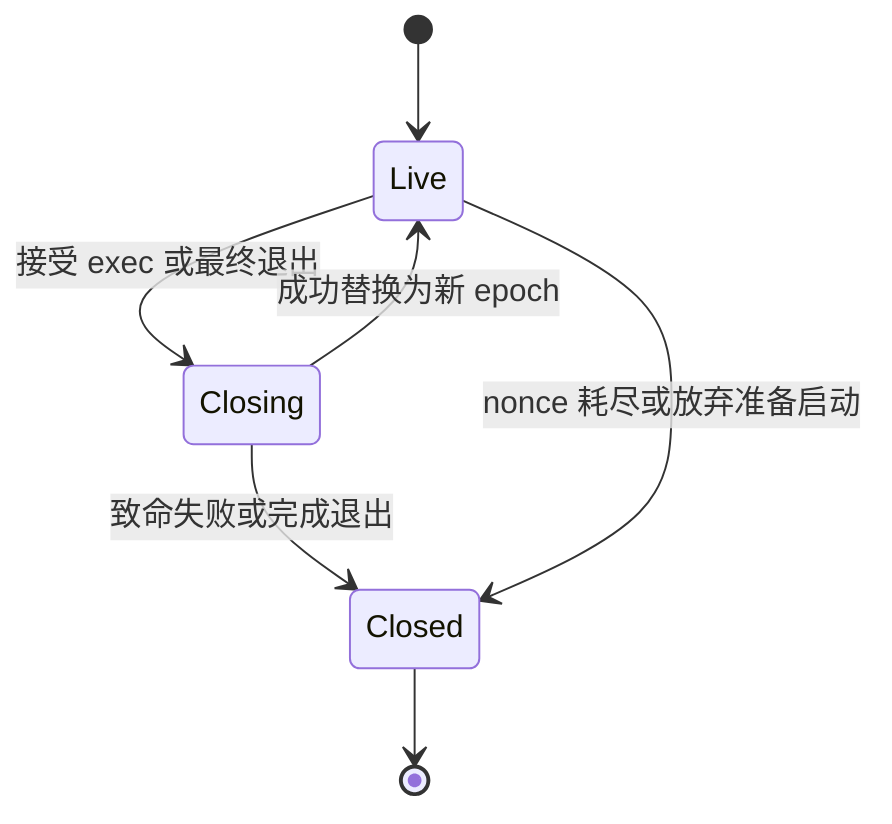

# G1-c 技术手册：原 Process 映像关闭与一次性初始启动

更新：2026-10-19。本切片基于 main `7c675e1d3efe46587edeebe14bd90ac1a842ffbf`。
它将现有 HOS2 Process 映像身份接入不可逆 exec／exit，并把原 init 装载窗口变成一次性启动绑定。
回归、构建入口和验收要求见 [开发与验证手册](../tests/kernel/control/PROCESS_IMAGE_G1C.md)。
本文描述实现；本候选完整 CI、普通产品和 Linux／CPU 组合运行须单独记录实际来源与结果。

## 1. 修改的原有对象

| 原对象／源码 | 当前职责 |
| --- | --- |
| [Process](../kernel/asterinas/kernel/core/src/process/process/mod.rs) | 唯一 `hepta_image: Mutex<ProcessImageState>`；保留原 tasks、VMAR、cgroup、PID 生命周期 |
| [image.rs](../kernel/asterinas/kernel/core/src/process/process/image.rs) | 同锁 epoch、boot-local nonce、Live／Closing／Closed 和首次启动状态；分配不回绕 |
| [init_proc.rs](../kernel/asterinas/kernel/core/src/process/process/init_proc.rs) | 原 loader／PosixThreadBuilder 完成后生成私有 `PreparedInitialProcess`；消费后登记并启动原任务 |
| [execve.rs](../kernel/asterinas/kernel/core/src/process/execve.rs) | TaskSet 接受替换后、发送其他线程 SIGKILL 前关闭旧映像；成功提交新 epoch，致命失败保持关闭 |
| [线程 exit](../kernel/asterinas/kernel/core/src/process/posix_thread/exit.rs)、[进程 exit](../kernel/asterinas/kernel/core/src/process/exit.rs) | group／最后线程退出先 Closing，最终 VMAR 清理前 Closed；普通非最后线程退出保持当前映像 |
| [hepta_control.rs](../kernel/asterinas/kernel/core/src/device/misc/hepta_control.rs) | 保存 exact Process 的 Weak 与完整 `ProcessImageKey`；QueryAbi 检查同一 Process、同一 key 和 Live |

旧实现把 epoch 放在 AtomicU64，把 `(epoch, nonce)` 放在另一个 Mutex，只在成功 exec 后推进 epoch。
本切片让旧映像的拒绝边界位于不可逆替换／退出入口，并用一个原 Process 状态表达整个关系。
没有增加资源预算实例、累计用量账本或替代 Hepta 的交付 owner。

## 2. 映像身份和关闭语义

`ProcessImageKey` 包含完整 `u64 epoch` 和 `u64 nonce`，字段私有。
nonce 从原 boot-global AtomicU64 通过 `fetch_update` 与 `checked_add` 分配；零保留为尚未分配。
所有打开操作都在 Process 的 image mutex 内取到同一 key。
独立 Process 分配不同 nonce；同一 Process 的线程共享 key；成功 exec 的新映像获得新 epoch 和新 nonce。
HOSR 的 space ID 仍是 boot ID 前 8 字节加完整 nonce，完整 boot ID 在原响应字段中单独返回；wire 不变。

| 状态／事件 | 对新 open 和旧 fd 的影响 | 下一状态 |
| --- | --- | --- |
| Live，已有 nonce | 同 Process、同 epoch／nonce 的 QueryAbi 会话有效 | Live |
| Live，首次分配 nonce | checked 分配成功后该映像共享此 key | Live |
| nonce 耗尽 | 当前分配返回 `ENOSPC`；后续不重新分配 | Closed |
| TaskSet 接受 exec | 立即拒绝旧会话与新发现；发生在其他线程被 SIGKILL 前 | Closing |
| 成功替换且 epoch 可递增 | 旧 key 永久失效；清空 nonce，后续打开只创建新 key | 新 epoch 的 Live |
| 替换后致命失败／epoch 耗尽 | 原 SIGKILL 路径继续执行；原 key 不复活 | Closed |
| group exit／最后线程 exit | 先拒绝发现，最终清理前关闭 | Closing → Closed |
| 普通非最后线程 exit | 其他存活线程继续使用当前 Process 映像 | Live |

`commit_exec` 仅接受 Closing，先封闭旧状态再 checked 递增 epoch。
失败不会让旧 namespace 恢复；成功也不会恢复首次调度权限。
参数读取、路径查找、凭据准备和 `load_to_vmar` 均在 TaskSet 接受 exec 之前；这些失败保持原映像有效。
该顺序以实际 [do_execve](../kernel/asterinas/kernel/core/src/process/execve.rs) 为准，不能把 guest 的 EFAULT／ENOENT 称为不可逆入口之后的加载失败。

## 3. 私有一次性初始启动

原 init 加载仍支持原有 ELF／解释器／脚本语义。
`create_init_process` 构造原 Process 与 VMAR，用同一个 `VmarHandle` 交给 `create_init_task`，后者实际装载并交给 `PosixThreadBuilder`。
原 Task 加入该 Process 的 TaskSet 后，私有 `PreparedInitialProcess::new` 取得 Process、VMAR、主 Task 的 Arc 及当前 key。
这个值没有 Clone，生产构造点仅在上述原装载路径。

运行时 `with_initial_image` 验证当前 Process VMAR Arc、唯一 main Task Arc、Task 的 Weak Process、结束／exec 状态，以及同锁 image key 和首次启动状态。
Task 与 VMAR 的关系来自同一私有构造链；代码没有声称读取未运行 Task 私有 ThreadLocal 来重新认证地址空间。
“尚未运行”的依据是原任务未发布／未调度的私有路径，加上原 Process 的一次性首次启动状态；`is_exited() == false` 只是附加拒绝条件。

`FirstRun` 的路径只有 `Unprepared → Prepared → Started` 或普通 fork 的 `Unprepared → Started`。
`resume(self)` 在所有绑定验证成功后消费原状态，释放 Process 锁，再执行原 bootstrap session／group／PID 登记和 `Thread::run`。
普通 fork 仍通过原 `Process::run`，仅增加内部首次启动 claim；已准备或已启动的 Process 无法从另一入口再次被调度。
放弃尚未消费的 token 时，只关闭其匹配 epoch／nonce 的准备映像；过期 token 不能关闭后来替换出的映像。

这是一条实际装载到首次调度的绑定，并不证明文件内容不可变或具备 Hepta 授权。
当前 token 内没有 `NativeGrant`，PID1、UID0、路径名、环境变量和构造器存在均不是授予依据。

## 4. 锁序、调度和原 CPU 尾账

完整初始绑定的锁序是 **VMAR → TaskSet → image**。
现有 `/proc/[pid]/mem` 和 `maps` 已在 VMAR 锁内查询 main thread，因此不能新增 TaskSet → VMAR 的逆序。
exec／exit 在既有 TaskSet 临界区内短暂取得 image；open／QueryAbi 只取 image；image 方法不回取 VMAR、TaskSet、membership、runqueue 或 CpuControl。
初始绑定释放这些锁之后才登记 PID 或进入 scheduler；不在 image 临界区进行用户复制、I/O 或资源结算。

关闭状态用于拒绝新的映像发现与会话。
原 [CpuControl](../kernel/asterinas/kernel/core/src/fs/fs_impls/cgroupfs/controller/cpu.rs)、
[native owner](../kernel/asterinas/kernel/core/src/fs/fs_impls/cgroupfs/controller/cpu/native.rs) 和
[runqueue](../kernel/asterinas/kernel/core/src/sched/sched_class/mod.rs) 的 retained owner 与尾段结算继续沿自己的原生命周期。
映像关闭不释放旧 debit owner，不清零累计用量，不替换 BOOTTIME，也不修改 Linux cpu.max 的统计／预算。
因此本候选继续执行七个原 CPU 缺陷负控和完整普通产品回归，核实组合改动没有破坏已有行为。

## 5. 当前 HOS2 边界

设备仍只宣告 QueryAbi；ReadUsage、InstallBudget、QueryDelivery、RetireThrough 的有效帧仍返回 `EOPNOTSUPP`。
open 的原权限规则、HOS2 framing、错误码契约和 QueryAbi wire 不变。
device 保存的 Weak Process 必须升级并与当前 Process `Arc::ptr_eq`，之后在原 image mutex 检查完整 key 与 Live。
fork 的继承 fd 因 Process 不同被拒绝；dup 和同 Process 线程共享会话；成功 exec 后旧 fd 失效。

当前无资源效果，session 检查位于既有 ioctl 解码入口。
这不是“关闭后跨 CPU 不会再线性化任何 grant 效果”的证明：未来资源操作必须在用户复制之后、原资源 owner 的操作线性化点再次验证 canonical grant。
授予与撤销必须和效果共享原 owner 的同步边界，不能把本切片的 image mutex 单独当成 grant 撤销机制。

## 6. 下一 ReadUsage 切片的具体接合点

先做一个新建、未发布、无 tracer、无共享 VM 的静态 ELF 正例。
对实际映射的同一不可变字节做认证，绑定入口、VMAR 和已消费的 prepared token；初期不接受 PT_INTERP 或 shebang 的受信任形态。
普通无 grant 的 Linux 程序保留既有行为。
以下源路径仍须在开放正例前闭合：

| 现有路径 | 需要实施的最小约束 |
| --- | --- |
| [proc mem](../kernel/asterinas/kernel/core/src/fs/fs_impls/procfs/pid/task/mem.rs) | 已打开 handle 每次写仍须验证受保护映像；只禁止新 open 无法封住旧 handle |
| [ptrace 状态](../kernel/asterinas/kernel/core/src/process/posix_thread/ptrace/mod.rs)、[ptrace syscall](../kernel/asterinas/kernel/core/src/syscall/ptrace.rs) | 包括 TRACEME、已有 tracee 的数据和寄存器写；初期直接拒绝受信任映像的不支持形态 |
| [VM mapping](../kernel/asterinas/kernel/core/src/vm/vmar/vm_mapping.rs) | RX 页表标志不足以证明不可写；默认 MAY_WRITE 与 forced alien fault／COW 必须纳入保护 |
| [clone](../kernel/asterinas/kernel/core/src/process/clone.rs) | `CLONE_VM` 不必包含 `CLONE_THREAD`；无 grant 的新 Process 仍可能写共享 VMAR，不能只给子进程空权限 |
| [原 native CPU owner](../kernel/asterinas/kernel/core/src/fs/fs_impls/cgroupfs/controller/cpu/native.rs) | 在原 membership／owner 上绑定一个 N0 单 CPU、100 ms observe 目标；检查对象代际、原同锁快照和 canonical grant 的存续 |

先取得真实静态映像 ReadUsage 正例和拒绝／关闭回归，再宣告该操作。
之后的 InstallBudget／QueryDelivery／RetireThrough 继续沿原 CapSpace reservation 和原 owner 完成，不能另造控制器、用量表或 delivery outbox。
Hepta 的 `(scope_id, operation_id)` 与 `(boot, CapSpace, sequence)` 持久绑定、同 D 查询、Unknown 保留及连续前缀退役仍属于后续原 AuthorityOps 路径。

