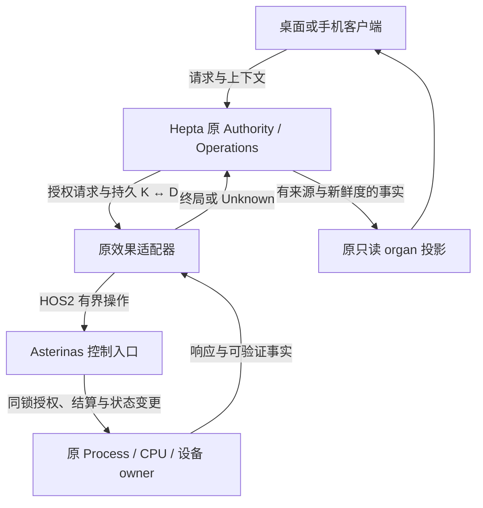

# R11 项目进度审计：G1-b、Linux 工作负载与 Hepta organ

PR #205 已完成完整内核、七项生产反向控制、普通 Linux 工作负载与 CPU 限额的独立验收，并于 2026-10-19 11:34:07 UTC 正常合入主干。项目具备真实普通内核、固定 Linux 工作负载和 Rust／Hepta 只读交互基础；下一主线是最终 Process/exec 授权、原 Operations K↔D 持久交付与真实 Hepta W1。

审计日期：2026-10-19。11模块及文档身份见[module-matrix.json](module-matrix.json)。本版在工作区维护后重建，已恢复原资料与仍缺本地WIP原件的边界见[RECOVERY.md](RECOVERY.md)，不冒用旧文件hash。

本报告与精简原始证据位于 `results/integration/2026-10-19-g1b-usage/`。各独立复核保留自己的范围、源码和观察时间；原件清单见 [files-manifest.json](files-manifest.json)，最终源码、CI 与实际合并绑定见 [final-state.json](source-publication/final-state.json)。

## 1. 结论与证据完整性

**继续受控 Asterinas fork，是当前有证据支持的工程路线。** 已有真实普通内核启动、原 core/OSTD 测试、Linux 工作负载、原 CPU owner 限额与生命周期切片，以及 Linux 宿主上的 Rust Shell／Hepta 只读交互。完整 Hepta organ 仍缺最终 Process/exec 授权、原 Operations 到内核的 K↔D 持久交付、四个实际资源操作与 Asterinas 中真实 Hepta W1；手机和本机图形桌面也尚未取得完整运行资格。现有材料没有证明必须替换 OSTD 或从零重写全部 Rust kernel 才能解除这些阻塞。[系统架构](../../../docs/ARCHITECTURE.md)、[Native ABI](../../../docs/NATIVE_ABI.md)、[Hepta 接合](../../../docs/HEPTA_INTEGRATION.md)

当前不能把项目概括为“只有文档”，也不能说它已经是可投入生产的 AI native OS：

- **A04 三份详细手册已经进入 main**，并有完整 Ubuntu Linux32、SCM/CLOEXEC 与 RLIMIT 的实际切片。固定00e的INDEX末段曾仍统称外部候选；PR205的f966/4d已经修正两处陈述，明确#202已导入并保留历史。当前候选不再有这项导航缺口。
- **#203 已实际通过并合入；#204 已合入报告整合。** 原API已恢复；10:59:34又从官方恢复了与原SHA完全一致的ZIP，原serial/ELF/source成员可从中提取。旧派生review JSON仍缺失，11:06已从同一归档新做green core/OSTD、source/三ELF/QueryAbi独立实读；七负控、full32和CPU仍保留维护前审查范围，不把字节复核称为重新运行。
- **G1-b 内部纳秒记账与一致快照切片已随 #205 正常合入。** 执行头 `4d3011cf…` 的五项检查全部成功；官方原 artifact 独立核对 7054 个源码文件、完整 core220/OSTD221（3 soft skip）、七负控与普通 Linux/CPU。实际合并 `b8d5af3f…` 的 tree 与执行头完全相同；没有继承早期 WIP 或 #203 的资格。四项资源操作仍关闭。
- **Hepta #2885 有真实 Rust/shared UI 与只读网关进展，11:18 的新读取仍显示两个 required 失败。** main、head、base 都未变化，仍 Draft/open/unmerged/blocked；最新 52 项均已结束，为 24 success、14 failure、8 cancelled、6 skipped。原 22 份响应和两份 job 日志已恢复，旧派生 review/manifest 原字节没有恢复。[Desktop 恢复说明](desktop-progress-ci/RECOVERY.md)、[Hepta 恢复说明](hepta-current-review/RECOVERY.md)

### 1.1 审查范围

本文逐项核对A00–A10的主干、候选、实际执行、文档入口与下一门禁，组合固定Git、原响应、已发布资料及新独立审查。它不宣称本次重新完成全仓逐行安全审计，也不把历史host、guest、负控和不同source的计数相加为新运行。旧WIP原件缺失与#203原归档已恢复分别标注，完整恢复细节另见[RECOVERY.md](RECOVERY.md)。

## 2. 固定源码与发布状态

| 对象 | 身份／状态 | 本报告采用的边界 |
| --- | --- | --- |
| 本轮起始 main | `00e2652c62ce6e34337d8f5bc3f3366b089c3d9c`；tree `c9980015c74a6118bb49e5bdd17a6244974a41be` | #203/#204 已合的文档与产品基线；不是持续追踪移动 main |
| #203 实际执行 | head `775061af51e6ee91fce290d5855e24a276292e14`；tree `afeb331293025ca7a63678167211de109e997110` | run `39219341861`，artifact `12172041618` 的原资格身份 |
| #203 实际 merge | `5218f67e7d15adabcfcadef041f1cf26b0447e99`；08:35:37 UTC | 恢复的 08:23 API 当时仍 Draft/open，不覆盖后来实际合并；prospective `1e2f80da…` 不是真实 merge |
| #204 实际 merge | `00e2652c…` | 只整合报告和主线文档；R10 subtree `5f95cfc0be662f843a3547444670b85328579ff8` 保留，不增加产品运行 |
| G1-b 首次远端候选 | `f9669912e2886190429187e14753d62b2060bd5f`；tree `659736e494be76de1d29e2e80972b126071e5cfe` | 与维护前本地 `83e122d…` 的 tree 相同；源码可恢复，旧本地 review 字节不能由此恢复 |
| **PR205 实际执行头** | **`4d3011cf9f92e25fc1b0d7371e9cdbbd5a8b7930`；tree `8eb809136a402cc54ba049b1e40dd174308c923f`** | 相对 f966 仅 `tests/spec/test_a06_final_accounting_source.py` 一文件变化；产品、工作流、七负控均不变 |
| Hepta 原固定快照 | main/base `f8c9419df6ddeb36ff8b522a50219981fb8d9345`；#2885 `43a638d4e25ebc5a8b06babcd1c75c9acac53179` / tree `84fdaf39799cef5676c2d3e2029f55c69d0ecd21` | 09:06–09:07 原观察恢复，Draft/open/unmerged/blocked，不能写成恢复时刻的新轮询 |

来源：[已发布主线整合说明](../../../docs/R11_REPORT_INTEGRATION.md)、[Desktop 原 API 恢复审查](desktop-progress-ci/recovery-review.json)、[Hepta 原响应恢复审查](hepta-current-review/recovery-review.json)、[模块矩阵](module-matrix.json)、[PR205](https://github.com/TrillionniumFoundation/trillionnium-os-desktop/pull/205)。

### 2.1 PR205 首次失败、当前验收与实际合并

首次 f966 的 G0 实际失败为旧 source-string 断言没有适配 `Option` 纳秒端点。执行负责人已读取原日志并将修正限制在上述一个 host guard 文件；不能以“产品未改”抹掉这次失败。恢复环境首次本地 spec36 另有两个缺 seed 环境 ERROR，固定 `96605cf…` 上游树与原 `6b5de5…` lock 输入恢复后，原 spec36 与 backend26 才通过；没有更换 pin。本恢复者核对了固定 Git 单文件差异，没有独立重跑这两组测试。

当前 4d 的 [A06 run 39240728276](https://github.com/TrillionniumFoundation/trillionnium-os-desktop/actions/runs/39240728276)、G0 `39240728311`、A01 `39240728231` 与两项 CodeQL 检查全部成功。A06 job `118020615962` 于 10:53:58–11:13:24 UTC 完成。官方 artifact `12182038203` 的 154,979,607 字节与 SHA-256 `ef5d93159c1663fb30d3cf8e39e969525bbfa03b4fedc4db10ef4c87b035d655` 已核对，完整 ZIP 1172 成员 CRC 通过；原始运行与新独立复核分开保留。

在四份独立产物审查无阻塞、当前五项检查成功后，#205 于 **11:34:07 UTC 正常合并**为 `b8d5af3f82aa8c262560fd52a79408a18e18bde1`，tree **`8eb809136a402cc54ba049b1e40dd174308c923f`**，等于实际执行头的完整 Git tree。合并后已重新 GET 确认 merged=true、merged_at、main ref 与实际 merge commit；未把 prospective SHA 当实际合并。首轮 f966 的 A06 `39239994032` 与本轮4d分开，没有拼接为一次成功 CI。[实际合并记录](source-publication/root-pr205-merged-pr.json)、[合并树](source-publication/root-pr205-merge-commit.json)、[原件独立复核](pr205-runtime-review/README.md)

## 3. A00–A10 全模块进度与具体文档入口

本轮重新核对 **62 个不同文档／契约／验证入口的固定执行源码内容**；其中 60 个路径在起始 main 已存在，2 个 G1-b 手册由 #205 新增并已合入。当前候选内容与旧 main 内容是否相同，由 blob 身份单列；partial clone 中未取回的旧 main blob 不声称已逐字读取。历史 R9 的 53 个 INDEX 链接、47 个一跳手册、225 个嵌套目标是原审查分母，不改称本次重跑。[模块矩阵](module-matrix.json)、[历史 R9 文档审查](../../../results/integration/2026-10-18-objective-history/module-documentation-review.json)

“存在具体入口”不代表每个模块已完工。部分模块使用共享架构契约和专项验证手册，不能宣称都有两本独占命名、覆盖全部未来功能的文档。

| 模块 | 主干／候选与实际进展 | 开发与验证入口 | 技术入口 | 未闭合／下一门禁 |
| --- | --- | --- | --- | --- |
| **A00 集成与证据治理** | #203/#204/#205 已合；本轮模块审计、实际运行与原件清单归档 | [方案](../../../docs/agents/PLAN.md)、[STATUS](../../../docs/STATUS.md)、[验证](../../../docs/VALIDATION.md) | [架构](../../../docs/ARCHITECTURE.md)、[决策](../../../docs/DECISIONS.md)、[产品范围](../../../docs/PROJECT.md) | 原件按固定来源保存；继续统一各轮文档状态，历史记录保留各自范围 |
| **A01 构建与启动** | 完整 Asterinas、原 OSDK、ordinary/ktest 已接入；#205 core220/OSTD221（3 soft skip） | [构建](../../../support/build/README.md)、[ktest](../../../support/build/ktest/README.md) | [上游锁](../../../support/upstream-lock.json)、[owner 接合](../../../docs/ASTERINAS_CPU_OWNER_G1A.md) | 最终 ELF/锁/快照已核实；x86 QEMU 不覆盖裸机与 ARM64 guest |
| **A02 HOS2 ABI** | 五操作 codec 已合，实际设备只开放 QueryAbi；历史 ABI78 为原 R10 host 证据 | [A02 收口](../../../tests/abi/A02_REVIEW_CLOSURE_2026-10-17.md)、[证据完整性](../../../tests/abi/A02_EVIDENCE_INTEGRITY_2026-10-17.md) | [Native ABI](../../../docs/NATIVE_ABI.md) | 四剩余操作的真实 copyout/replay/retire 要进入普通 guest，报文不等于效果 |
| **A03 control core** | 原身份/revision/投递/终局/退役模型已合；std/portable 各225有重叠，Loom19模型及19零分配场景为历史 host 证据 | [验证](../../../tests/control/VALIDATION.md)、[运行入口](../../../tests/control/run-validation.sh) | [API contract](../../../libs/os-control/API_CONTRACT.md)、[ABI](../../../docs/NATIVE_ABI.md) | 真实内核锁/授权/CAS 和原 Operations K↔D；host 锁不授 IRQ/SMP 资格 |
| **A04 Linux/ELF** | #202 已导入三详细手册；SCM/CLOEXEC、RLIMIT 与 full Ubuntu32 已合 | [Linux](../../../tests/workloads/linux/README.md)、[rootfs](../../../support/rootfs/README.md)、[full32](../../../tests/workloads/linux/FULL_UBUNTU_PROFILE.md)、[RLIMIT](../../../tests/workloads/linux/RLIMIT_NOFILE.md)、[SCM](../../../tests/workloads/linux/SCM_RIGHTS_CLOEXEC.md) | [兼容策略](../../../docs/LINUX_COMPATIBILITY.md)、[GAPS](../../../compat/linux/GAPS.md)、[A04 交接](../../../docs/agents/handoffs/A04_LINUX_HEPTA_ELF.md) | 真实 W1、必要 SQLite/IPC/子进程/块设备持久性与跨系统重启恢复、sender in-flight FD 和 W3；旧 Debian 原件仍缺 |
| **A05 内核控制/授权** | 实际 ioctl/FileLike、Process/exec 边界、QueryAbi 已合 | [A05 交接](../../../docs/agents/handoffs/A05_KERNEL_CONTROL.md)、[内核控制测试](../../../tests/kernel/control/README.md) | [ABI](../../../docs/NATIVE_ABI.md)、[安全恢复](../../../docs/SECURITY_AND_RECOVERY.md) | 生产 bind/最终 grant 未开放，四操作关闭；先 G1-c 可信最终身份和撤销负例 |
| **A06 CPU owner/usage** | G1-a、#199 结算、#201 保留、#203 clock/handoff 与 #205 内部纳秒 usage 均已合 | [G1-b](../../../tests/organ_backend/CPU_USAGE_G1B.md)、[clock/handoff](../../../tests/organ_backend/CPU_CLOCK_HANDOFF_CI.md)、[结算](../../../tests/organ_backend/CPU_CONFIG_SETTLEMENT.md)、[owner 生命周期](../../../tests/organ_backend/CPU_OWNER_RETENTION.md)、[cpu.max](../../../tests/organ_backend/CPU_MAX_CONFIG.md) | [G1-b](../../../docs/ASTERINAS_CPU_USAGE_G1B.md)、[G1-a](../../../docs/ASTERINAS_CPU_OWNER_G1A.md)、[N0](../../../docs/ASTERINAS_CPU_BANDWIDTH_N0.md)、[organ 后端](../../../docs/ASTERINAS_ORGAN_BACKEND.md) | live ReadUsage、physical switch 原子性、完整 SMP、cpu.weight shared revision 未闭合 |
| **A07 原 Hepta owner** | desktop 只读 observer/Session、默认关闭 Objective/history 客户端已合；Hepta #2885 只读候选未合 | [服务](../../../services/hepta-os/README.md)、[运行](../../../services/hepta-os/RUN.md)、[Objective](../../../services/hepta-os/OBJECTIVE_TRANSPORT.md)、[history](../../../services/hepta-os/OBJECTIVE_HISTORY.md)、[原 owner probe](../../../tests/integration/hepta/ORIGINAL_OBJECTIVE.md) | [观察契约](../../../services/hepta-os/CONTRACT.md)、[接合](../../../docs/HEPTA_INTEGRATION.md)、[history JSON](../../../services/hepta-os/OBJECTIVE_HISTORY_CONTRACT.json) | 原 issuer/final-use、首次发送前持久原请求、K↔D、确认退役和 Asterinas W1/G2 |
| **A08 Android/APK** | host 来源工具与 gap 文档已合；历史184 host测试不代表 Android guest | [来源工具](../../../support/android/README.md)、[固定 host 审查](../../../tests/workloads/android/evidence/2026-10-17-commit-bound-audit/README.md) | [Android策略](../../../docs/ANDROID_COMPATIBILITY.md)、[接口](../../../compat/android/INTERFACES.md)、[kernel gaps](../../../compat/android/kernel-gaps.json) | 固定 A0/AOSP 输入；Binder/ART/MAC/Zygote/图形/APK 与 ARM64/16KiB 分别验收 |
| **A09 设备/VMM/DMA** | metadata 模型和只读 preflight 已合，尚无真实设备资格 | [生命周期](../../../support/vmm/device_lifecycle/README.md)、[硬门禁](../../../support/vmm/GATES.md) | [硬件风险](../../../docs/HARDWARE_AND_DRIVERS.md)、[来源](../../../support/vmm/PROVENANCE.md) | 真实 device owner/IOMMU/IRQ/reset/quiescence/恢复；VMX 基础不等于完整 VMM 或手机 BSP |
| **A10 Rust Shell/UI** | desktop Linux host Shell/Session、CJK/XIM、原 owner 观察已合；Hepta shared UI 有实际通过步骤也有失败 | [UI运行](../../../support/ui/RUN.md)、[聊天工作区](../../../support/ui/CHAT_WORKSPACE.md)、[observer](../../../support/ui/HEPTA_OBSERVER.md)、[实际Shell](../../../tests/ui/ORIGINAL_OBJECTIVE_SHELL.md) | [桌面协议](../../../docs/DESKTOP_UX.md)、[新鲜度](../../../ui/shell/OBSERVATION_FRESHNESS.md)、[CJK](../../../support/ui/CJK_RENDERING.md)、[X11 IME](../../../support/ui/X11_IME.md) | 修 #2885 原 timeout/Architecture；真实效果接合、Asterinas 图形和移动端 profile 另验 |

A04 当前手册身份可以直接从已恢复 Git 确认：Linux README 26,278 字节/blob `aab5533c…`，rootfs README 6,864/blob `050bb4fe…`，GAPS 27,683/blob `071b6ab4…`。原“仍只有外部候选”已在当前候选INDEX明确限制为原记录时点，这项导航修正已随PR205合入；新Ubuntu32不能补成旧Debian13四原ELF/rootfs已恢复。[模块矩阵](module-matrix.json)

## 4. #203 历史运行的能力、分母和恢复限制

现已恢复的原 API 确认，精确头五 checks success；A06 job `117950707764` 于 07:57:12–08:16:28 UTC success。官方 artifact `12172041618` 元数据为 **153,302,416 字节**，SHA-256 `7ec32457b02fe4fa897b32ce937f2c34d9cd0bfae034da4c5f74626ecfc539bf`。10:55的恢复包当时只含原元数据；随后10:59:34执行负责人从官方重新下载同一ZIP，字节数/SHA完全一致，1172成员、383,208,710解压字节的CRC全通过。原producer归档已恢复，旧派生review不冒造。[原API恢复审查](desktop-progress-ci/recovery-review.json)、[新增归档恢复收据](pr203-restored-artifact/archive-recovery.json)

维护前独立审阅实际读过该ZIP的1172成员、6591个tracked source文件及普通产品区间三个相同快照。11:06的新审阅器已从恢复后的同一官方原归档，独立重读完整green core/OSTD、ordinary QueryAbi及三ELF；6591源路径/mode/blob对照775固定Git，三个源码快照相同。此次没有再逐源blob计算全部size/SHA，也未重新复核七负控/full32/SCM/RLIMIT/CPU；这些下表条目仍采用原已发布资料与维护前实际观察。旧review JSON没有原字节，新的review是新证据，不是重跑产品。[已发布 STATUS](../../../docs/STATUS.md)、[时钟/handoff CI 契约](../../../tests/organ_backend/CPU_CLOCK_HANDOFF_CI.md)、[恢复范围](desktop-progress-ci/RECOVERY.md)

| 原验证层 | 维护前实际观察 | 不能外推的能力 |
| --- | --- | --- |
| core | 201 passed，0 failed/filtered/softskip；raw QEMU33 | 不含 G1-b 新19项 |
| OSTD | 221 reported passed，0 failed/filtered，3 softskip；执行下界218 | 合计 **422 reported / 419执行下界**，不将软跳过算成实际执行 |
| 普通 boot/QueryAbi | 14个精确行标记及顺序通过，raw33 | 四非 QueryAbi 操作仍关闭 |
| SCM/CLOEXEC 与 RLIMIT | 原收据分别27、37；probe ELF、kernel、serial身份绑定 | 当时独立审查未新写完整 marker parser；不证明并发exec压力或所有rlimit |
| 完整 Ubuntu32 | Linux与guest各32，stdout逐字相同、stderr空、进程0/raw33 | 固定 Ubuntu24.04 x86_64；不替代 Hepta W1、GUI或块设备持久性与跨系统重启恢复 |
| CPU配置/配额 | 原四配置与有限1/2vCPU均过原阈值 | `smp_qualified=false`；无严格1% SLA或完整SMP结论 |

普通 kernel SHA-256 是 `e1d5ec0f294d0fffe1c887f92e2b564aa9d967753e0d6f815894ca6490c779c5`。原 full32 为28个C、3个Python、1个实际 locked Tokio场景，673 runtime文件、79 ELF、5 workload ELF；Tokio1.47.1 的线程4/counter4000/async16等是原实际结果。旧 #203 的 1/2 vCPU 原 probe 收据绑定同一 `e1d5ec0f…` 普通内核；SMP=2 构建调用另行记录，这些有限配额结果仍不提供完整 SMP 资格。新纠正复核还独立流式确认已保存普通 `product-kernel.elf` 的 8,288,528 字节与上述 SHA；归档中的共享 target ELF 残留不作为原 quota 输入身份的替代证据。CI宿主编译器、OSDK、QEMU本体未全部随artifact保留，不能声称审阅器重建了原宿主工具。[历史身份纠正](pr203-identity-correction/README.md)、[完整Ubuntu profile](../../../tests/workloads/linux/FULL_UBUNTU_PROFILE.md)、[已合Linux结果](../../../results/compat/2026-10-19-full-linux/README.md)

新green复核实际确认core201、OSTD221 reported含3个VMX软跳过，执行下界419；QueryAbi各原标记一次、四操作disabled。三实际ELF已流式重算SHA，原QEMU本体不在archive，不能声称重算其宿主可执行文件。[新green/source独立审查](pr203-restored-artifact/green-independent-review/review.json)

### 4.1 七个完整生产负控

原七变异分别保留全部201测试、原断言、runner和锁，raw QEMU均65、原gate失败、无超时；这表示门禁检出指定错误，不计入正常core的成功分母。

| 变异 | 原 passed / failed | 原防线 |
| --- | --- | --- |
| owner-current-slot | 198 / 3 | 运行段 owner 不被当前 slot 替代 |
| clocksource-drop-fraction | 198 / 3 | 原ClockSource分数相位 |
| vdso-drop-fraction | 198 / 3 | vDSO相位发布 |
| vdso-skip-fault-mode | 200 / 1 | 原时钟失效模式 |
| handoff-drop-tail | 197 / 4 | 切换前尾账 |
| handoff-eligibility-first | 200 / 1 | 先结算后资格判断 |
| dequeue-drop-owner | 199 / 2 | wait/exit原owner保留 |

G1-b新增的第四个ClockSource失败属于新220集合，不回填#203。原绿色ELF在共享target被负控覆盖前保存，负控后原候选恢复；同一target下重新生成的bytes不能被重新定义为原绿色ELF。[CI契约](../../../tests/organ_backend/CPU_CLOCK_HANDOFF_CI.md)

### 4.2 CPU实际读数

以下原结果采用4秒、quota1000µs；数字来自维护前已核对的绑定收据，本恢复版没有发起新测量。

| period / 模式 | 原占比 | 原上限 |
| --- | ---: | ---: |
| 100000µs / read-only | 0.899889% | 1.2% |
| 100000µs / same-value | 0.878188% | 1.2% |
| 2000µs / read-only | 46.246698% | 52% |
| 2000µs / same-value | 46.298188% | 52% |

有界配额原1vCPU为1.000%/1.000%，2vCPU为0.834%/0.870%，通过原最大3%门槛。它支持该profile的限额/同值写行为，不证明任意调度类、迁移、IPI、hotplug、suspend/resume或严格N0误差上界。[N0范围](../../../docs/ASTERINAS_CPU_BANDWIDTH_N0.md)、[cpu.max开发手册](../../../tests/organ_backend/CPU_MAX_CONFIG.md)

## 5. G1-b 已合实现、19回归与当前完整资格

### 5.1 已恢复的技术结构

两本新手册和 [usage_tests.rs](../../../kernel/asterinas/kernel/core/src/fs/fs_impls/cgroupfs/controller/cpu/native/usage_tests.rs) 已从固定候选重新读取。测试文件35,603字节，SHA-256 `9199dee49d804bb3b217a417362ed78043bcb6ae7a23f3bb29191d8f7c304dcb`，19个`#[ktest]`名称与维护前交付一致。源码恢复支持下列设计事实；旧本地独立review文件没有因此恢复。[G1-b技术手册](../../../docs/ASTERINAS_CPU_USAGE_G1B.md)、[开发手册](../../../tests/organ_backend/CPU_USAGE_G1B.md)、[矩阵源码身份](module-matrix.json)

| 设计点 | 当前实现／目的 | 仍保留的限制 |
| --- | --- | --- |
| 唯一原账本 | 原CpuMax使用used_ns/cumulative_ns/window_start_ns/carry_debt_ns，Linux配置仍是µs；不建第二ResourceDomain/用量库 | cpu.weight未加入共享native revision |
| 同源时间与绝对端点 | 原RTC/TSC校准的BOOT/MONO相位；ClockSourceSample绝对纳秒端点求差，保留3GHz碎片小数 | 不可靠、回退、溢出拒绝；不伪造Jiffies/TSC纳秒fallback；休眠未资格 |
| 独立cycle高水位 | CFS/RT周期cursor与ns观察cursor分离，坏sample不回拨，恢复只算新suffix | 受控回归不证明全部硬件counter异常 |
| 同一切点与同锁快照 | 在同一paired cut上先结算本地运行段，再核对RCU Arc并取原bandwidth同锁快照 | 尚非live userspace ReadUsage；physical switch原子性、跨CPU rendezvous未证明 |
| 当前窗/debt/cumulative | used为当前窗实际执行，debt另列，cumulative随incarnation保留；同值/降cap不refill | 旧窗迟到interval、迁移与完整SMP另验 |
| period切换 | 真正变period后，native观察等到下一完整100ms窗起点；从10ms/1000ms回100ms不能立刻清污染 | Linux合法配置不都满足native N0 |
| 单CPU回退与SMP乱序 | 单CPU旧观察/配置永久fence；底层配置/eligibility钳到高水位；合法共享owner重叠区间不只因晚到锁就fault | overlap受控用例不等于liveSMP通过 |
| fault与Linux恢复 | accounting_fault持久；有限quota和native快照持续拒绝；原metadata gate允许时Linux max恢复不限额，不清native fault | Closed仍IsDead；Indeterminate/Overflow仍拒绝max，不能泛化所有错误可恢复 |
| 无伪造事件 | event_sequence=0、dropped_events=0、user_paused=false；ktest只在CLOCK缺席时一次初始化原RTC/TSC | 0/0不是可靠事件流；不重置现有时钟制造成功 |

### 5.2 19项测试如何覆盖

完整名称在JSON及开发手册中保留，按四组组织：

| 组别 | 数量 | 判据 |
| --- | ---: | --- |
| 相位与cycle | 4 | 3GHz碎片绝对端点、配置时cycle不混单位、可靠旧端点、硬件sample不可靠时不panic/回拨/重放 |
| 窗口与cap | 6 | 跨窗cumulative/debt、同值与降cap、短/长period返回、底层迟到同值写、共享owner重叠正区间 |
| profile与身份 | 4 | N0范围、单CPUwrapper、replacement需新绑定、deleted owner不可复活 |
| fault与metadata | 5 | Indeterminate/detach、clock不可用、观察回退、同值旧配置、累计溢出永久拒绝 |

它们使用真实未启动Process/Task/controller/owner lease和受控时钟，不称live scheduler。七负控的新实际精确失败数为 **3/4/3/1/4/1/2**，第二项唯一新增全名为 `aster_core::fs::fs_impls::cgroupfs::controller::cpu::native::usage_tests::fragmented_three_ghz_runtime_keeps_absolute_endpoint_precision`；原三个ClockSource失败保留。完整core不能缩成只跑19项，七负控不能换成host模型。

### 5.3 WIP实际历史与当前缺失原件

维护前的`wip-core-02`使用前16项新测试，原集合217，发生多项失败和raw0提前结束，没有完整summary。定向`diagnostic-unavailable-02`随后明确得到0passed/1failed/216filtered、raw65：`mark_as_dead`返回EBUSY，原因是deferred CPU accounting leases。前面的clock/native断言已经完成，失败发生在fixture释放顺序。

固定修复没有删除gate或人工RCU grace：runtime先drop；真实Process标记zombie；move root时保留当前RCU lease；drop Process/TaskSet，再drop最终Task；最后原严格mark_as_dead。19项业务断言未删。修改原live lease为None会制造delay-drop，单纯多drop一次task不能保证已退役lease消失；修复必须沿原生命周期。[已恢复开发手册](../../../tests/organ_backend/CPU_USAGE_G1B.md)、[实际测试源](../../../kernel/asterinas/kernel/core/src/fs/fs_impls/cgroupfs/controller/cpu/native/usage_tests.rs)

修复后维护前已实际观察`wip-core-03` **220passed/0failed/0filtered/0softskip、19新名、raw33、无超时、原run.py passed/OSDK0**。其serial历史SHA为`ab7ae20b3dafef9250d74e829fed703698f673061d47950eaa8e96fb12ef705e`，27,372字节；该原serial、实际ELF和独立review现缺失。本恢复版不重造它们，也不声称重新计算该SHA。

该成功属于`00e`上的17个dirty/untracked路径；118输入清单只覆盖受保护上游输入，不能当原子完整dirty-source快照。它不是83e/f966/4d精确头运行，更没有提供同候选OSTD、七负控、ordinary或Linux32资格。首次源审查还曾发现stale配置可回拨窗口/refill的真实边界，最终用高水位与profile区分修正，不能把所有早期问题统称“只是环境”。

最终PR205已经使用原pinned nightly、原OSDK与锁，通过完整core/OSTD、七负控、普通boot/QueryAbi、SCM/RLIMIT/full32、CPU四配置和原有界1/2vCPU，并完成独立原件复核。这仍限定为本切片的内部纳秒计费与一致用量资格；**ReadUsage、InstallBudget、QueryDelivery、RetireThrough四操作仍关闭**，生产可信bind/grant、完整G1-b、physical-switch及SMP结论仍按明确范围判定。

### 5.4 最终 4d 的真实运行与独立复核

本节只使用 A06 run `39240728276` / artifact `12182038203`，不是 WIP 或 #203 的继承结果。实际普通内核为 **8,388,960 字节**，SHA-256 `1897671a81fab04dc8d5e995b42b62256ec2bd13043ad78a93684d46f60c0fe0`；本轮 1/2 vCPU 配额构建的输出也与它逐字相同。

| 当前运行 | 已核实的结果 | 资格范围 |
| --- | --- | --- |
| 完整源码 | 7054 路径、mode、Git blob、size、SHA-256 与固定 Git 逐项相符；普通启动前、启动后、guest 后快照一致 | 源码身份一致，不称全仓逐行安全证明 |
| 完整 core | 220 passed、0 failed/filtered/soft skip；名字严格等于原201加新19 | 原 QEMU33，无超时 |
| 完整 OSTD | 221 reported passed，0 failed/filtered，3 VMX soft skip；实际执行下界218 | 两套件合计441 reported、438实际执行下界 |
| 七完整生产负控 | 每轮220同名测试；精确失败3/4/3/1/4/1/2，原QEMU65/gate1，无额外失败 | 各仅一个声明生产路径变异；七tree/补丁/ELF与候选恢复已独立核实 |
| QueryAbi | 14个原标记各一次；四资源操作 disabled | 无生产grant、资源effect或Hepta durability |
| SCM / RLIMIT | Linux与guest同探针ELF，各27/27、37/37，原输出和顺序相符 | 保留原接口切片边界 |
| Ubuntu32 | Linux和guest各32；逐项stdout字节完全相同，stderr为空、程序exit0 | 673运行时文件/43,204,445字节/79 ELF/5 workload ELF与实际initramfs绑定；不是Hepta W1 |

[绿色套件与源码独立复核](pr205-runtime-review/green-independent-review/review.json)、[七负控独立复核](pr205-runtime-review/negative-independent-review/review.json)、[普通工作负载与CPU独立复核](pr205-runtime-review/ordinary-cpu-review/review.json)、[argv与输入链补充](pr205-runtime-review/ordinary-cpu-review/input-chain-supplement.json)

CPU 四配置保留 quota1000µs、约4秒观测和原验收阈值，以下是从当前原始串口重新计算的结果：

| period / 模式 | 实际占比 | 原上限 |
| --- | ---: | ---: |
| 100000µs / read-only | 0.927026% | 1.2% |
| 100000µs / same-value | 0.899906% | 1.2% |
| 2000µs / read-only | 45.846786% | 52% |
| 2000µs / same-value | 46.307548% | 52% |

原有配额 probe 的1vCPU两次为1.000%/1.100%，2vCPU两次为0.905%/0.934%，全部通过原3%上限。2vCPU原init、BSP+1 AP与不限额约198.65%/198.79%的聚合基线已核实，满足原>145%前提。这支持有界配置回归，不证明严格1% SLA、完整SMP或真实物理context-switch原子性。host QEMU/编译器可执行文件未随原artifact保留，审阅使用原记录的身份绑定，没有宣称重新散列全部宿主工具或重跑产品。

## 6. Hepta #2885：最新状态与原日志支持的事实

最后一次有界 GET 的 main/PR 观察为 **11:15:05–11:15:06 UTC**，精确 head checks 为 **11:18:04–11:18:05 UTC**。main/base 仍 `f8c9419…`，PR head 仍 `43a638d4…`；52 项 checks 全部 completed，24 success / 14 failure / 8 cancelled / 6 skipped，两项分支保护 required 仍 failure。PR 仍 Draft、open、merged=false、blocked。mergeable=true 只表示 Git 可机械合并，不代表正常门禁通过。因为 head/base 未变，下述固定源码和原日志的有限结论继续适用；这次新状态读取没有重新审查其它红项的根因。[新状态原件及复核](hepta-final-status/README.md)

### 6.1 已恢复证据与原时点

原main/PR观察为09:06:40–09:06:42 UTC，checks为09:07:23.616。恢复后的22份JSON序列化字节数与维护前输出相同，10份源码Git blob匹配保存的compare；旧完整manifest丢失，不能独立核对全部旧JSON SHA。新manifest只绑定现在恢复出的文件。原两份日志字符串保留；这不是仅凭摘要重新编造结果，也不是恢复时刻重新检查GitHub。[恢复收据](hepta-current-review/recovery-receipt.json)、[新恢复清单](hepta-current-review/recovered-files-manifest.json)

#2885的215文件包含UI194、gateway12、native resources2、scripts4，以及workflow/技术文档/Cargo.lock各1。原快照52checks为22success、14failure、8cancelled、6skipped、1neutral、1running；14failure含汇总gate，不能当14个独立漏洞。CI required和Architecture required均failure，Draft/open/unmerged/blocked。[新派生有限审查](hepta-current-review/recovery-review.json)

### 6.2 实际通过与实际失败

| 原source job内容 | 结果与范围 |
| --- | --- |
| shared Rust presentation/renderer、strict CSP/no-threads build | 通过，是真实候选开发 |
| 默认实际browser layouts/pixels、gateway preview/transport | 原步骤通过；本恢复版未下载全部像素/ELF/trace实物重审 |
| populated owner/pixels | 原步骤通过，但明确是fixture，不证明生产owner attached |
| real missing-owner status/cancellation | 6例5pass/1fail；Chromium1280超过90秒，后续unrouteAll遇已关闭page/context/browser；cleanup异常不足以证明最初timeout原因 |
| Architecture执行记录契约 | 45项43pass/2fail；临时fixture repo缺`hepta_ci_module_paths.py`，原依赖导入失败 |

UI run39217348025的source/base都在真实unavailable status/cancellation步骤失败；本轮恢复的是source全文，不能未经base全文认定两者同一根因。应读取真实trace/error context、修等待与取消/关闭次序，保留missing-owner原断言。Architecture两失败为`test_shell_preserves_test_targets_and_strict_lint_arguments`和`test_shell_test_failure_has_no_lint_pass_receipt`，应把实际必需helper纳入临时repo，再跑原绑定/失败无假lint-pass收据测试，不跳过门禁。[恢复日志结论](hepta-current-review/recovery-review.json)

### 6.3 原owner与安全债仍未闭合

默认gateway为not attached，非GET405；可选Weak adapter仅有界只读metadata。typed mutation/recovery表达、Host/Origin检查和owner lease观察，都不证明原issuer、RunStart、Objective/Operations、FinalUse与实际效应已装配。本次没有改原Objective/Operations实现，不能将UI候选写成G1-c/d或Asterinas W1完成。[恢复的固定源码审查](hepta-current-review/recovery-review.json)、[候选接合手册](https://github.com/TrillionniumFoundation/hepta-private-ci/blob/43a638d4e25ebc5a8b06babcd1c75c9acac53179/apps/hepta-control-ui/MAIN_INTEGRATION.md)

旧#2815/#2882/#2883状态来自各自更早的固定快照和已发布R10记录，未合入的变化不计入main f8。Fleet单文件本地41tests/Clippy不等于远端134包通过；原scoped构建ENOSPC没有测试完成收据。五行workflow环境修复的本地102Python/18小crate也不能把skipped/0steps的scoped lane改写为134包重跑。

R10的13项依赖拒绝是**本地8漏洞+5unmaintained、涉及8包**；新远端cargo-deny失败无原log时不能复制这个数字。Bazel helper unwrap、Windows路径/句柄/ACL/删除边界或fixture失败分别保留，不能归到13项依赖。旧Windows某legacy场景sentinel读None/is_dir=false也不足以独立证明物理删除。本轮不复写原安全包，不把Hepta所有失败归为UI的单一原因。[R10原完整审计](../../../results/integration/2026-10-19-g1-owner/README.md)

## 7. 作为Hepta organ使用，需要闭合哪些链条

当前Linux宿主交互／只读观察工具有实际实现；Asterinas CPU后端有原owner与Linux限额基础；完整AI native OS organ仍须把可信决定、有限执行与持久终局连在同一链上。UI展示原owner事实，不另建一份“已完成”的数据库；内核执行可撤销、可验证、有明确scope的操作。[产品范围](../../../docs/PROJECT.md)、[Hepta接合](../../../docs/HEPTA_INTEGRATION.md)

### 7.0 原只读 organ 与效果执行的职责

Hepta 的原 `TrustedReadOnlyOrganV1` 是事实投影边界，不持有 IO 或 capability。桌面／手机可消费该投影，但实际控制必须通过原 Authority／Operations 所管理的有界 effect adapter；不能把只读 organ 改成隐藏的特权执行器。内核只实施已经授权的有限操作和资源约束，Hepta 原 Objective／Operations 保持计划与持久终局的唯一来源；模型或 UI 重启不应让内核约束失效。

这张图是目标接合关系；当前实际内核只开放 QueryAbi，原 K↔D 和设备效果尚未全部接通。计费、线程／进程身份、预算、事件与投递不能在 UI 或适配器中另建权威副本；缓存应携带原 owner 身份、版本与过期语义。[Hepta 接合契约](../../../docs/HEPTA_INTEGRATION.md)、[当前固定 Hepta 有限审查](hepta-current-review/recovery-review.json)

### 7.1 G1-c：最终Process/exec可信授权

可信启动顺序应为创建停止任务、附着原资源owner、装入最终ELF/形成exec身份、ActivateGrant、交付必要只读句柄、再Resume。普通exec不自动重授旧能力；PID复用、旧exec、旧boot/CapSpace都不能复用旧grant。

普通guest必须证明open/dup/fork/SCM_RIGHTS不增权，覆盖跨scope、撤销、祖先预算/lease变化、replace/delete以及final-use时刻重新核对。独立恢复supervisor的CPU/内存/I/O/祖先资源须受保护，不能被受管理对象耗尽。[A05交接](../../../docs/agents/handoffs/A05_KERNEL_CONTROL.md)、[安全恢复](../../../docs/SECURITY_AND_RECOVERY.md)

固定4d源码已形成[下一G1-c设计收据](g1c-design/process-exec-owner-design-4d3011cf.json)，核对19个源码位置，尚无新实现或运行。当前ElfLoadInfo不认证最终不可变映像；只持Arc<FileLike>不保证映射字节不变。原check_session仅在usercopy前，未来必须复制后解析真实handle，并在原owner锁下重验准入/撤销。membership→tasks锁序不可反转，exec不可回退边界与exit_group要关闭旧image；NativeGrant值构造不等于真实授予权限。第一个有界正向切片应先固定直接加载、无解释器的不可变静态ELF和单CPU观察者，再取得实际ReadUsage正/负例；该设计没有提前开放任何操作。

### 7.2 G1-d：原Operations持久K↔D

K是原操作主键`(scope_id, operation_id)`，二者是StableId；payload/semantic digest是内容校验，不能与K混写。D是特定boot/CapSpace的有序投递身份，不是K。

1. 原Operations在首次ioctl前持久保存K↔D、完整请求、target、boot/CapSpace、sequence和不可变digest；不在desktop另起并行outbox。
2. 原内核mutation锁内完成最终grant/ancestor lease/identity/revision/CAS核对及旧运行段结算，再施加有界效果。
3. copyout丢失、bridge被杀后重试/查询同一D，不为未知结果随意发新D；history gap/not seen保留Unknown，不改成NotApplied。
4. 原owner持久确认终局响应后，按连续前缀RetireThrough；旧代际、旧boot、已退役晚到请求不得再执行。

当前原DurableOperationIntent尚无已闭合D接合；应扩展原owner并跑崩溃证据。SQLite去重事务不等于与ioctl跨介质原子提交，1024投递窗口也不是终生操作次数。QueryAbi加四剩余操作的完整协议，需要真实重复、撤销、copyout丢失、重启、退役与未知结果验收。[ABI](../../../docs/NATIVE_ABI.md)、[control契约](../../../libs/os-control/API_CONTRACT.md)、[Hepta接合](../../../docs/HEPTA_INTEGRATION.md)

### 7.3 G2/W1：运行原Hepta ELF

固定原Agentd/AppServer ELF、依赖、rootfs与工具链，在普通Asterinas中记录run→K→D→原对象/revision→终局→退役。实际AF_UNIX/peer credential、epoll/futex、锁、子进程/exec、SQLite WAL/fsync/目录持久化要来自真实trace；同D重发、bridge kill、owner/kernel重启、旧boot请求及撤销必须测试，同时证明不相关任务存活。

Ubuntu32是W2的具名子集，不能直接成为W1或W3。原SCM fork/exec继承不等于并发exec压力；RLIMIT分配测试不代表sender in-flight FD或所有resource limits；本地进程kill后的SQLite回归不自动覆盖真实块设备路径上的fsync、崩溃与跨系统重启恢复；该门禁可用受控虚拟块设备验证。[Linux gaps](../../../compat/linux/GAPS.md)、[full32](../../../tests/workloads/linux/FULL_UBUNTU_PROFILE.md)、[SCM](../../../tests/workloads/linux/SCM_RIGHTS_CLOEXEC.md)、[RLIMIT](../../../tests/workloads/linux/RLIMIT_NOFILE.md)

完整功能链形成后，才适合用相同输入比较固定策略、非AI反馈、Hepta+Linux和Hepta+Asterinas的效果/成本。当前没有这些对照数据，不能从AI native命名推导吞吐、能耗或可靠性优势。

## 8. 继续fork还是重建Rust kernel

固定vendor为Asterinas v0.19.0、commit`c4b7ed575b7b32773475b194d2ad41fb6d03765b`、tree`96605cf64aeae2d34f29b97e85eff9315fe10a8e`、nightly2026-07-21。原README列x86_64 Tier1，IntelTDX/**ARM64**/RISC-V64 Tier2、LoongArch64 Tier3；OSDK有Aarch64 target、core/OSTD有ARM实现。**不能再说Asterinas没有ARM64内核支持。** 上游基础部署、Hepta ARM Linux host与本项目ARM guest/手机/Binder/GPU/16KiB资格仍是不同范围。[上游锁](../../../support/upstream-lock.json)、[vendor README](../../../kernel/asterinas/README.md)、[OSDK架构](../../../kernel/asterinas/osdk/src/arch.rs)

官方2026-10-13公告还确认：v0.19.0已有DRM/GEM dumb buffers/KMS，Xorg modesetting配Mesa软件OpenGL；AArch64 QEMU virt可进入BusyBox；OSTD提供Intel VMX基础，完整兼容/dev/kvm仍属后续层；官方Asterinas NixOS内可自编译内核并在nested QEMU启动。不能笼统说上游没有图形、ARM或自举。这些是上游能力说明，不自动授予本项目Robrix、GPU硬件、手机BSP、Hepta W1或项目自身可复现自举资格。[官方0.19.0公告](https://asterinas.github.io/2026/10/13/announcing-asterinas-0.19.0.html)

Framekernel把unsafe集中在OSTD/framework，OS services采用safe Rust，仍是同一地址空间；它不是硬件地址空间故障隔离证明。复用OSTD重建某些上层服务，是可评估的中间方案，不必一开始重写boot、页表、IRQ、调度和驱动。[架构](../../../docs/ARCHITECTURE.md)

当前阻塞主要是可定位的owner尾账、clock相位、snapshot、Process/exec授权、Linux具体接口、原Hepta持久投递和device owner。#199–#203及G1-b已显示多项可沿原Task/VFS/CpuControl小范围修复；没有可复现证据证明它们与OSTD根本冲突。继续维护完整上游来源、可审阅差异和统一owner，避免复制线程表/VFS/quota/事件日志或持久状态。

| 情况 | 先验证什么 | 路线 |
| --- | --- | --- |
| 缺syscall、owner接口或授权流程 | 固定真实最小workload，局部实现并过同一正负门禁 | 继续fork；缺功能本身不要求全重建 |
| 单个service需更强故障隔离或不同生命周期 | 预先规定隔离/延迟/恢复目标，复现反例，对比局部修复、用户态隔离与OSTD上层替换 | 可重建这部分上层，保留合格OSTD/驱动/Linux接口 |
| 固定W0/W1/N0反复违反安全/延迟目标 | 精确source/tool/hardware与原trace；不得弱化gate后称成功 | 同条件替代小原型、成本和维护证据，再决定扩大 |
| OSTD内存/IRQ/调度边界本身不可调和 | 证明局部与上层方案都不能满足明确约束 | 才进入framework/全内核重建立项，保留回退镜像 |

任何替代都应过相同W0/W1、授权/撤销/重复/恢复门禁，保留HOS2、原K↔D和必要Linux子集，提供等价boot/隔离/设备/recovery证据。代码行数、Rust比例、品牌和一个Hello内核都不是替代成熟profile的理由；本轮未启动第二内核实现。

### 8.1 继续 Asterinas 的具体实现顺序

下面是基于当前源码的实施顺序，不是已取得的运行资格。具体 G1-c 字段、调用点与锁序见[固定源码设计收据](g1c-design/process-exec-owner-design-4d3011cf.json)。

| 切片 | 在现有 owner 上改什么 | 进入下一切片前的验收 |
| --- | --- | --- |
| Process 映像生命周期 | 在原 Process 的映像状态中保存代际、nonce 与可关闭状态；创建／fork 默认无 grant；最终装载后、任务运行前提供只能消费一次的准备态；exec 不可回退边界和退出关闭旧身份 | 普通 guest 的 QueryAbi、fork／exec／exit 身份与旧句柄负例；四操作继续关闭，先证明生命周期没有授权绕路 |
| 第一个真实 ReadUsage | 固定直接加载的不可变静态 ELF 与可信启动输入，沿原资源 owner 附着和激活；复制用户请求后在原 owner 锁下复验；先固定单 CPU、100 ms 的 N0 profile | 真授权者读到同一 revision 的纳秒用量；open／dup／fork／SCM、旧映像／旧代际、撤销和错误 profile 不增权；不能以 PID1、UID0、路径或 Arc<FileLike> 代替映像认证 |
| 原生预算与投递 | 在原控制器的配置／revision／使用量锁内接 InstallBudget 与 CAS，原时钟和尾账先结算；补原 QueryDelivery 与连续前缀 RetireThrough | 真实普通 guest 验证重复、冲突、撤销、父预算、copyout 失败、窗口满和已退役晚到；不另建第二套 CPU 账本 |
| 原 Hepta 持久交付 | 在原 Operations 主键下持久保存 K、D 与规范请求，再调用内核；查询同 D、持久确认后退役；恢复 supervisor 有独立且受保护的资源 | bridge 被杀、请求后响应前崩溃、进程／内核重启、旧 boot、未知终局的原始 trace；不同内容同 D 必须冲突，原 Unknown 不因新预算碰巧相同而变成功 |
| 原 Hepta W1 与必要 Linux 接口 | 固定原 Agentd／AppServer ELF、依赖及完整镜像，沿真实 syscall trace 修 AF_UNIX、epoll/futex、进程／FD、SQLite／文件系统等缺口 | 同一个真实 Hepta 任务在 Asterinas 中闭合原 owner、K↔D、资源作用与恢复；Ubuntu32 继续回归，不能用替身 daemon 替代 W1 |
| 桌面与设备 profile | 在上一链上接 GUI、输入、窗口与实际 device owner；Android 先固定 AOSP/profile，手机驱动另有板级输入 | 本机应用和设备的实际行为、断连／重启／撤销与资源边界都有原件，才能扩大到下一硬件或应用范围 |

首次正向 ReadUsage 必须认证实际用于映射的同一不可变字节，并绑定最终 VMAR／入口；不可信 ptrace、process_vm、共享映射等写入别名尚未排除时，不授予该观察权限。仅哈希文件后重新映射，或仅保留 Arc<FileLike>，不能替代此条件。

D 先在既有 CapSpace 投递表中预约完整规范请求并预留结果槽，释放投递表锁后，才进入原资源 owner 的 mutation 锁完成最终准入、结算、CAS 和终局发布；资源锁内不得反向取得投递表锁。跨目标的同 D 去重属于原 CapSpace 投递命名空间。[原锁序](../../../docs/NATIVE_ABI.md)

LLM 推理和任务规划保留在 Hepta 用户态；内核热路径采用确定性的授权、记账和状态机。CPU quota 不能代替 GPU、DMA、存储或网络隔离。AI native 的收益要在相同任务和输入下比较延迟、完成率、恢复、资源开销与推理成本；当前没有这些对照数据，不能预设性能优势。

### 8.2 如果确需自己的 Rust kernel，应怎样重建

首先考虑以 OSTD 为基础重建有明确冲突的上层 OS 服务。OSTD 已提供 framekernel 所需的安全抽象，但复用其 API 仍需遵守内存、并发和硬件契约；safe Rust 不自动证明授权正确、崩溃持久性或 DMA 隔离。[官方 Framekernel 说明](https://asterinas.github.io/book/kernel/the-framekernel-architecture.html)

若可复现反例进一步证明 OSTD 本身无法满足事先确定的目标，再固定单一 ISA 与 QEMU 机器，从以下顺序推进完整基础重建，并始终保留现有可启动分支作对照：

1. **启动与内存基础。** 固定启动协议、物理内存管理、页表／用户态边界、异常、中断与可信时间源。把必要 unsafe／汇编限制在明确的底层抽象并审查其安全契约，不承诺硬件访问可以完全没有 unsafe。
2. **进程与资源 owner。** 线程、进程映像身份、调度、跨 CPU 生命周期、纳秒计费与有限预算统一在原生 owner；先通过当前 N0、时钟、尾账、撤销和故障正负例，再增加架构或并行范围。
3. **最小真实用户态。** VFS、描述符、内存映射、ELF、必要 IPC、网络与块设备；Linux syscall 是映射到同一原生对象的兼容层，不建并行进程表、第二调度器或第二权限账本。以真实 W1 的 trace 决定优先子集。
4. **原生控制与持久恢复。** 保留 HOS2、原 Hepta K↔D 和明确 Unknown 语义，运行同样的真实授权、重复、copyout、重启与退役测试。只有 Hello World 或 BusyBox 能启动，不能算替代了当前已通过的工作负载。
5. **图形、Android 与真实硬件。** 在同样的隔离和恢复判据下逐项补驱动、设备生命周期、BSP、图形和兼容服务。先固定一套可复现硬件，再扩大；驱动、ABI 与恢复成本都计入路线比较。

重建的入口是测量证据，而不是 Rust 代码比例或品牌命名。阶段验收以相同任务和原门禁为准；人员、硬件和目标应用尚未固定时，不给没有依据的工期或完成百分比。

## 9. 桌面、手机客户端、Android与BSP应分别验收

若目标先是手机作为交互客户端，或控制现有Linux/Android设备，可以单独推进客户端和受控端agent/profile；仍须接原系统权限、窗口/输入、后台、断连恢复与同一可信owner。页面或共享renderer能打开，不证明远端效果已执行，也不代表Asterinas已运行手机OS。

**本机桌面/W3：**固定实际GUI/浏览器应用，验证显示/合成器、Wayland/Xwayland或明确替代协议、输入/IME、字体、音频、D-Bus/portal、文件选择及应用启动/关闭/恢复。历史Linux host Shell、137 UI通过/2 CJK ignored与阶段图属于原profile，不直接授予Asterinas图形栈资格。[桌面协议](../../../docs/DESKTOP_UX.md)、[UI运行](../../../support/ui/RUN.md)

**Android A0：**先固定x86_64/4KiB/软件图形、AOSP tag/manifest/product、system/vendor、VINTF/HAL、ART/Bionic与原Android对照。Binder引用/线程/oneway/嵌套/死亡/FD/可信身份、seccomp、SELinux或等效MAC、init/Zygote/system_server、pressure/lmkd、DirectBoot/Keystore与APK场景各有门禁。APK能安装不等于完整兼容，ARM64/16KiB、32位native、图形音频/后台/通知/设备服务另测；认证、DRM与授权服务更后面单列。[Android策略](../../../docs/ANDROID_COMPATIBILITY.md)、[接口](../../../compat/android/INTERFACES.md)、[gaps](../../../compat/android/kernel-gaps.json)

**device/VMM/BSP：**当前固定IOMMU路径共享页表、使用`PciDeviceLocation::zero`且缺device/group参数，原source gate拒绝把metadata模型当真实隔离。需要真实owner、pinned frame/IOVA/alias生命周期、cache/barrier、IRQ generation、quiesce/reset-before-free及恢复。VMX/EPT基础不等于完整VMM/GPU指派，也不证明AMD SVM或ARM EL2。手机要固定设备、boot chain、SoC/GIC/timer/MMU、存储网络、显示触摸、音频摄像、modem/IMS、PMIC/thermal/power和suspend/resume，取得实机证据。[A09门禁](../../../support/vmm/GATES.md)、[来源](../../../support/vmm/PROVENANCE.md)、[硬件风险](../../../docs/HARDWARE_AND_DRIVERS.md)

## 10. 下一步的实际交付门禁

| 顺序 | 工作 | 必须交付 | 当前状态 |
| --- | --- | --- | --- |
| 1 | G1-b内部切片资格 | 最终树core/OSTD、7完整负控、actual ELF/锁/source、ordinary/QueryAbi/SCM/RLIMIT/full32、四配置/配额 | 已在4d独立验收，#205正常合入同树b8d5af3f |
| 2 | Hepta #2885正常门禁 | 保留原断言修timeout/cancellation和Architecture helper，两个required与其余真实失败收口 | 最新11:18双required仍红，同head未合入 |
| 3 | G1-c | 最终Process/exec grant、跨scope/旧代际/撤销/继承不增权、独立恢复资源 | 未开放生产可信激活 |
| 4 | G1-d | 原Operations写前K↔D、同D重试、CAS/撤销、未知/copyout/reboot、确认后退役 | 未闭合 |
| 5 | G2/W1与必要W2 | 原Agentd/AppServer、真实trace/持久链、无关任务隔离 | full32为已有子集；W1待执行 |
| 6 | W3/A0/设备 | 各profile原系统对照、真实输入、失败/恢复与实机原件 | host文档/模型存在，guest/硬件待验 |

模块可并行开发，但UI、设备和effect入口不能先于授权/持久语义获得“正式可控”状态。不提供没有分母的完成百分比或没有测量基础的日期承诺。

## 11. 新版证据交付与仍缺材料

| 包／材料 | 当前恢复范围 | 不能写成什么 |
| --- | --- | --- |
| Desktop历史API恢复 | 25原API，producer54文件；发布选择29文件/111,779字节，新manifest SHA `a2f4afcd9f36f36b01efc3b1f4bd1860ee0abc0f644e175cc16ffd120030b2e4` | 不是旧67文件包；其10:55 API-only范围保留，不改原包 |
| #203官方归档与新green复核 | 10:59:34恢复原ZIP；11:06新review重读core/OSTD/source/三ELF/QueryAbi | 旧派生review未恢复；新green复核不扩大为七负控/full32/CPU的新复核或产品重跑 |
| Hepta当前恢复 | 22原response、10blob已核源码、两实际日志；发布选择28文件/743,762字节，新manifest SHA `21e06723e9508eff04f91ea72b848494b6b5e07b6f74def631dec6b90b5be9b0` | 不是旧34文件包；旧JSON完整SHA清单和旧派生review/manifest未恢复 |
| G1-b WIP | 固定candidate源码、手册、19测试已恢复；220与失败结果作为先前观察保存 | 不造原serial/ELF/source快照或旧独立review，不改成4d精确运行 |
| 新PR205 | 4d完整CI、四份独立产物审查、7054源/原ELF/正负串口通过；11:34:07正常合入同树b8d5af3f | 内部切片资格；四资源操作、G1-c/d、真实W1与设备资格未因此开放 |

来源：[Desktop新清单](desktop-progress-ci/recovered-files-manifest.json)、[Hepta新清单](hepta-current-review/recovered-files-manifest.json)、[恢复说明](RECOVERY.md)。本目录已按各 producer 新 manifest 装配原始选件，最终清单逐文件绑定大小与 SHA-256。完整官方大 ZIP 与 ELF 通过官方 artifact 身份引用；本次精简选集保留原始串口、输入记录、差异和源/ELF 身份，没有重新打包 R10 的 111MB 历史证据。

R10原目录保留其本地attempt01/02、标记分帧失败、OSDK残留、封闭区间成功、f744/463f host gate失败和后续修正等历史。旧残留writer没有确定归因，旧Windows读取None不扩大成物理删除；原source/CI时点保持。恢复版不覆盖旧包正文。[R10入口](../../../results/integration/2026-10-19-g1-owner/README.md)

根 README 仍为 0 字节。本次报告发布仅更新文档和结果；产品实现由已正常合入的 #205 提供，原 pins、锁与运行原件保持各自身份。产品验收、新独立原件审查、历史恢复与报告发布各有明确记录，报告提交不增加产品测试次数；后续主干变化应按新的固定源码另行验收。
